# Lôi Đài độc lập — Bộ concept V01 để duyệt

Ngày tạo: **2026-11-19**. Nguồn tạo: **built-in ImageGen**, `art_source: host_image`.

**Concept đã được người dùng duyệt ngày 2026-11-19**: “Artwork ổn, tôi duyệt. Hãy triển khai tính năng Lôi Đài theo đặc tả đã lưu, sử dụng bộ artwork này và bám sát game hiện tại.” Phê duyệt concept được ghi tại [approval lock](../../approved_pvp_concepts.lock.json). Manifest/generation report bên dưới giữ trạng thái lịch sử tại lúc sinh ảnh; không tự suy ra duyệt runtime. **Bối cảnh bàn giao ban đầu:** Đây là 11 bản artwork/mẫu bố cục, không phải ảnh gameplay của tính năng đã chạy, atlas hoạt ảnh hoặc map có collision. Không sửa code, luật Defense, asset đã duyệt hoặc tích hợp vào Phaser.

Đặc tả chức năng: [LOI_DAI_STANDALONE_SPEC.md](../../../docs/LOI_DAI_STANDALONE_SPEC.md).

## Danh sách duyệt

| Mã | Bản duyệt chính | Phạm vi |
| --- | --- | --- |
| 01 | [Rừng Trúc](01-rung-truc.png) | Clearing rộng, trúc/đá/đèn ở viền, vị trí phóng phi tiêu |
| 02 | [Địa Ngục](02-dia-nguc.png) | Đỉnh núi basalt, nham thạch bao quanh, nền thu hẹp |
| 03 | [Tương Dương](03-tuong-duong.png) | Sân thành, cổng/tường, vị trí bắn tên lửa |
| 04 | [Kiếm Hồ](04-kiem-ho.png) | Đảo đá, hồ ngọc, hai cầu và vị trí NPC giữa sân |
| 05 | [Độc Cô Cầu Bại](05-doc-co-cau-bai.png) | Một master still tóc bạc/áo xám/trọng kiếm, PNG có alpha |
| 06 | [Hiểm họa](06-hiem-hoa.png) | Bảng tám ô hình ảnh để chốt ngôn ngữ VFX |
| 07 | [Chia phe V02](07-chia-phe-v02.png) | Chính–Khán giả–Tà, ready/khóa, quyền chủ phòng |
| 08 | [Chọn map V02](08-chon-map-v02.png) | Năm thumbnail, chọn map, bật/tắt hiểm họa |
| 09 | [HUD trận](09-hud-tran.png) | 4v4, tỷ số, đồng hồ, cấp 30, HP/MP, hotbar |
| 10 | [Các trạng thái trận](10-trang-thai.png) | Countdown, xem trận, thắng hiệp, hòa, hết ván, lịch sử |
| 11 | [Menu và vào phòng](11-menu-vao-phong.png) | Chọn hoạt động, tạo/vào phòng, phòng đóng/lỗi |

**Hồng Mộc được tái sử dụng**, không sinh lại một map thay thế. Nó xuất hiện trong thumbnail và nền UI để giữ liên hệ với game hiện tại.

### Checklist phản hồi

- [x] 01 — Bố cục, vật liệu, màu và độ thoáng Rừng Trúc.
- [x] 02 — Bố cục Địa Ngục, độ đọc đá/nham thạch và hướng thu nền.
- [x] 03 — Bố cục và mức chi tiết Thành Tương Dương.
- [x] 04 — Bố cục, màu hồ và vị trí trung tâm Kiếm Hồ.
- [x] 05 — Danh tính/silhouette/trang phục/kiếm Độc Cô Cầu Bại.
- [x] 06 — Hướng hình ảnh từng hiểm họa và cảnh báo.
- [x] 07 — Màn chia phe, màu hai phe, trạng thái chưa ready.
- [x] 08 — Thẻ map và công tắc hiểm họa.
- [x] 09 — HUD gọn, dễ đọc, không che vùng chiến đấu.
- [x] 10 — Ngôn ngữ thông báo và lịch sử.
- [x] 11 — Menu vào Lôi Đài và trạng thái phòng.

Chỉ đánh dấu sau phản hồi duyệt rõ ràng của người dùng. Việc tạo ảnh không tự cấp art approval.

## Reference đã xem và art readout

- [Hồng Mộc trong game](../../../docs/evidence/sessions/loi-dai-v2-verified/hong-moc-wide.png): camera trên xuống ba phần tư, sàn rộng ngang, gỗ đỏ, mái ngói xám, khung HUD đen/vàng; nhân vật nhỏ hơn nhiều so với kiến trúc.
- [Rừng Trúc trong repo](../../reviews/renovation-v1/forest-native-1366.png): đất vàng/đá vụn, trúc xanh và vàng, foliage tập trung viền, đèn đá; sprite chibi áo lớp rõ và chân chạm đất. Ảnh mang nhãn review chưa duyệt, không suy ra phê duyệt production.
- [Concept Võ Đang](../../references/vo_dang_character_reference.png): đầu lớn vừa phải, tóc buộc, áo lớp, viền rõ, bảng màu than/trắng và năng lượng nhạt; dùng làm hướng tỷ lệ, không cắt thành atlas.
- [World reference](../../references/in_game_world_reference.png): thế giới phủ viewport, kiến trúc và foliage xếp lớp, nền vuông trục ngang.
- [Forest reference](../../references/forest_dungeon_reference.png): màu xanh ngọc, đèn ấm và cảnh quan dày ở viền.
- [Hell reference](../../references/hell_dungeon_reference.png): basalt tối/nham thạch cam; chỉ lấy palette/chủ đề, không kế thừa phối cảnh hay mật độ quân.
- [Anti-reference chất lượng](../../references/current_game_2026_10_29_placeholder_anti_reference.png): đã xem; không theo cây/hình khối phẳng hoặc nền lặp thô.
- [File mang tên anti-reference dashboard](../../references/current_codex_dashboard_anti_reference.png): đã xem; nội dung thực tế là concept Võ Đang, không phải dashboard. Không suy diễn nội dung từ tên file.
- Alias `assets/references/vo_dang_art_direction_reference.png` được tài liệu cũ nhắc tới nhưng không tồn tại khi kiểm tra; dùng file concept Võ Đang thực có ở trên, phù hợp ghi chú trong [reference inventory](../../references/README.md).

Mục tiêu đồng bộ: 2D raster wuxia chi tiết, góc nhìn không xoay, nhân vật chibi nhỏ, viền cảnh phong phú, vùng giữa đủ đọc trận 4v4, UI gần khung đen/vàng hiện tại. Không tạo bản đồ isometric hoặc dùng hình khối procedural làm final art.

## Nội dung bảng hiểm họa 06

1. Phi tiêu: bay/va chạm, **không cảnh báo**.
2. Tên lửa: mũi tên cháy và va chạm. Cơ chế cảnh báo vẫn chưa chốt.
3. Đá nứt/chuyển thành nham thạch.
4. Ba mức thu nhỏ nền an toàn.
5. Cảnh báo chém nửa bản đồ.
6. Đòn chém nửa bản đồ.
7. Nhiều điểm cảnh báo sét.
8. Sét rơi tại các điểm.

Đây là tám ô trình bày concept, không phải tám frame cùng hoạt ảnh, không có timing/hitbox và chưa chứng minh chuyển động.

## Nội dung bảng UI

- 07 là góc nhìn chủ phòng: 3 Chính + 2 Khán giả + 3 Tà = 8 người. Người chưa chọn phái bị mờ/khóa; hai phe còn mỗi bên một ô trống.
- 08 cho thấy năm map, Rừng Trúc đang chọn và Hiểm họa đang bật. V02 đã loại HUD Defense khỏi nền.
- 09 minh họa HUD PvP cấp 30, hai phe, tỷ số và đồng hồ; không có tượng/wave/túi đồ/bình thuốc.
- 10 gồm sáu trạng thái trình bày riêng. Thông báo thắng/hòa/kết thúc chỉ là overlay tạm thời, không phải đề xuất lưu lịch sử kết quả.
- 11 là **ba màn/trạng thái khác nhau trong luồng**, không phải ba phương án chức năng để lựa chọn; dòng tiêu đề do model sinh không thay đổi đặc tả.

## Giới hạn và phần cần xử lý trước production

- Mọi tên, số HP/MP, tỷ số, thời gian, icon và rank pips trong ảnh chỉ là minh họa. Không lấy giá trị hoặc số pips model vẽ làm tuning hay luật mới. Tái sử dụng icon kỹ năng đã duyệt khi làm UI thật.
- Bảng 10 dùng lại đồng hồ 03:00 ở nhiều ô; khi hiện hòa do hết giờ, UI thật phải phản ánh đồng hồ đã hết. Các actor còn đứng trong ô kết quả chỉ minh họa nền, không là bằng chứng trạng thái sống/chết.
- Ảnh 03 có dải trời/núi mỏng ở mép trên. Khi dựng map phải bỏ/repaint phần gợi chân trời này để giữ camera orthographic từ trên xuống như game.
- Mép đá Địa Ngục chỉ là hình thức concept: không được biến thành tường/void chặn người quay lại. Luật đã chốt vẫn cho đi bộ/lướt từ nham thạch về nền an toàn.
- NPC 05 có alpha thật, nhưng còn soft halo và giá trị alpha tối đa 254; cần làm sạch matte/độ đục và vẽ sprite đúng scale. Không thu nhỏ portrait rồi coi là sprite hoàn chỉnh. Chưa có bốn facing hoặc frame idle/cast.
- Kích thước và tỷ lệ PNG không hoàn toàn đồng nhất (ghi trong manifest), không được stretch ảnh làm UI/map runtime. Menu thật cần tách frame/icon, dùng text/state sống và bố cục responsive.
- Chưa có terrain/scenery tách lớp, collision, spawn markers, atlas/JSON, pivot, animation timing hoặc tích hợp server/client.
- Chưa chạy Phaser, kiểm tra camera, chuyển động, Y-depth hoặc multiplayer cho tính năng mới. Chưa đạt cổng ART-01/runtime approval từ các concept này.
- Chỉ sản xuất asset/animation/tách lớp và tích hợp sau bước duyệt phù hợp; giữ nguyên asset đã được duyệt của game.
- Không tạo WebM/MP4/GIF hay recording.

## Nguồn và kiểm chứng

- Công cụ tạo ảnh: **built-in ImageGen**, không gọi CLI/API fallback. Model ID và chi phí không được tool trả về nên không gán tên model/chi phí giả.
- Prompt và input từng lần: [generation-prompts.json](generation-prompts.json).
- File, kích thước, mode/alpha, SHA-256, trạng thái: [manifest.json](manifest.json).
- Kiểm tra PNG/copy/provenance: [validation.json](validation.json).
- Reference chỉ dùng định hướng/biến thể theo art game; các reference chưa xác lập license không được sao chép vào runtime bundle.
- Không đổi luật/gameplay, không đánh dấu checklist đặc tả là hoàn thành.

### Các bản thử giữ lại

- [07 ban đầu](iterations/07-chia-phe.png): thay bằng V02 để sửa chân dung phái và lựa chọn của chủ phòng.
- [08 ban đầu](iterations/08-chon-map.png): thay bằng V02 để xóa HUD Defense còn sót ngoài cửa sổ.

### Capability diagnostics

[doctor.json](doctor.json) là lần đầu: `encoding.stdout` FAIL do cp1252; đã xử lý bằng `PYTHONUTF8=1`, kết quả mới ở [doctor-utf8.json](doctor-utf8.json): **0 FAIL, 1 WARN, 7 MISSING**. Đây là diagnostics môi trường, không phải kiểm chứng chất lượng asset.

WARN giữ nguyên: `python.path — other python.exe on PATH: ~/.windows-build-tools/python27/python.exe; ~/AppData/Local/Microsoft/WindowsApps/python.exe`. Interpreter đã thực dùng: Python 3.13.5, `F:/Programs/Python313/python.exe`.

Các MISSING tùy chọn: `deps.resvg-py`, `media.api.openai`, `media.api.gemini`, `media.api.xai`, `media.api.byteplus`, `media.api.fal`, `cli.grok`. Chúng không chặn route host_image đã dùng thành công. Không dùng code-drawn art hoặc video route.

## Xem từng bản

### 01 — Rừng Trúc

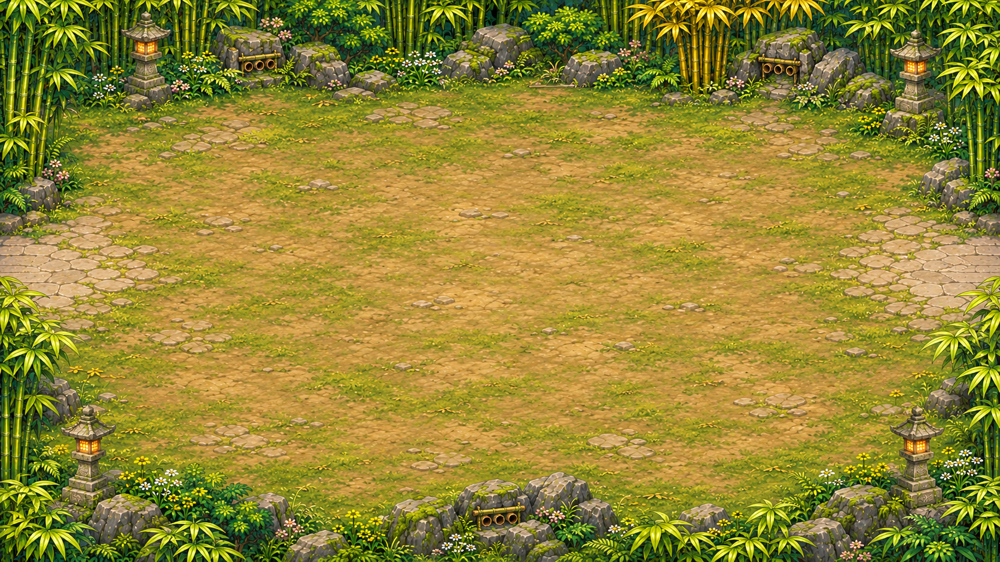

### 02 — Địa Ngục

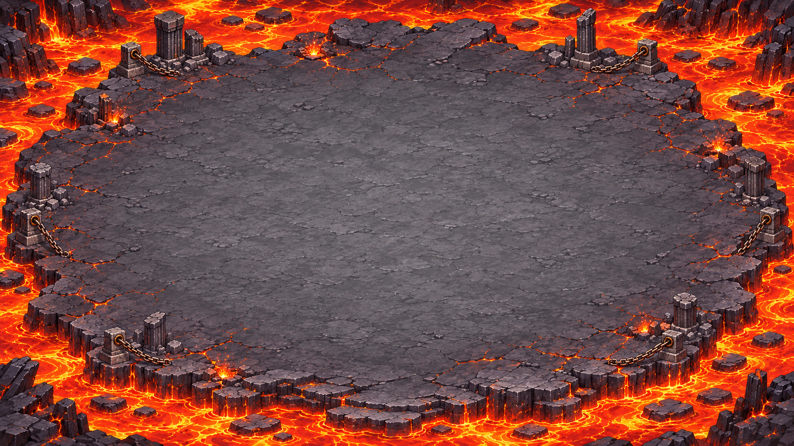

### 03 — Thành Tương Dương

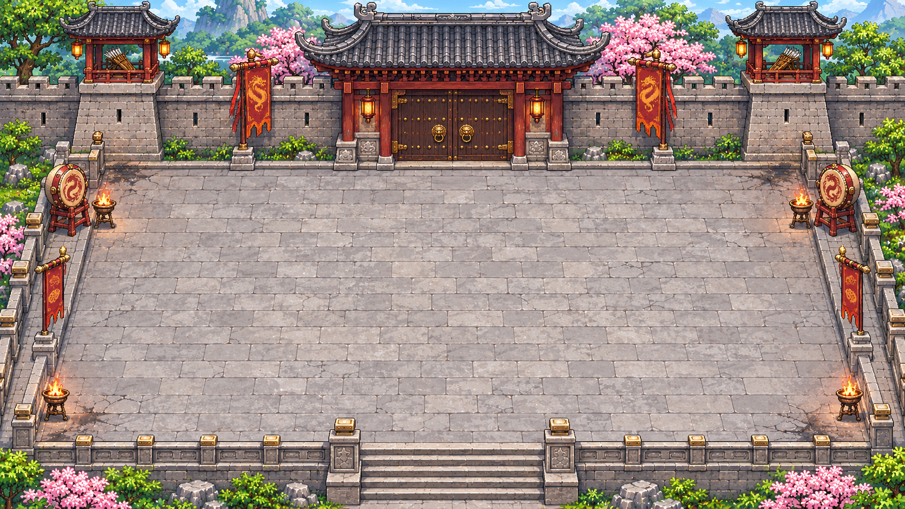

### 04 — Kiếm Hồ

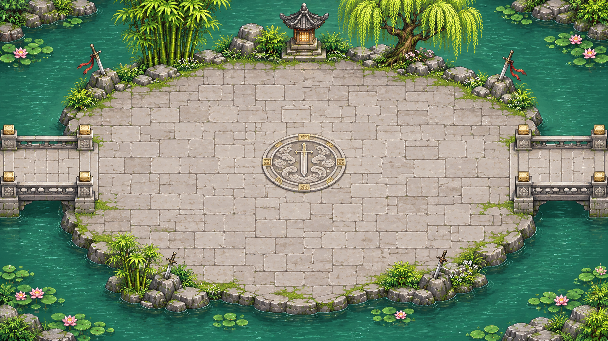

### 05 — Độc Cô Cầu Bại

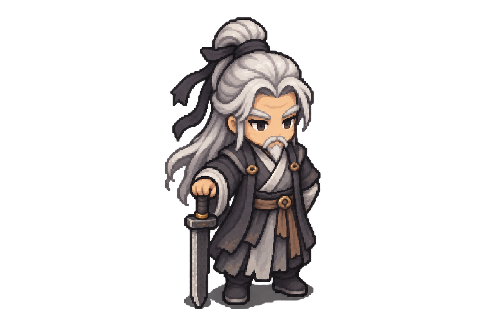

### 06 — Hiểm họa

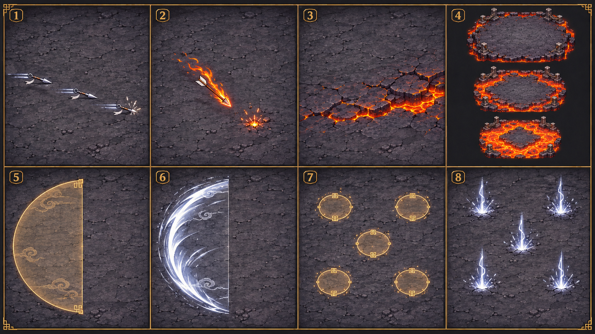

### 07 — Chia phe V02

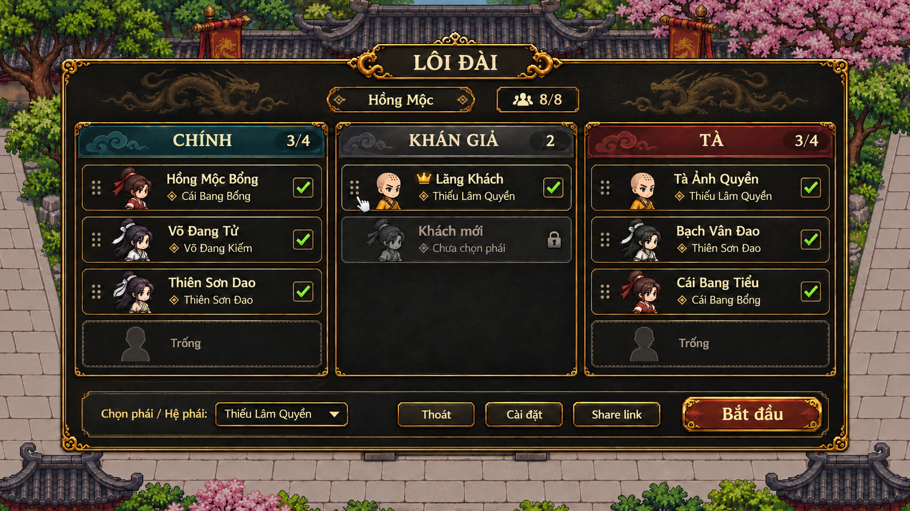

### 08 — Chọn map V02

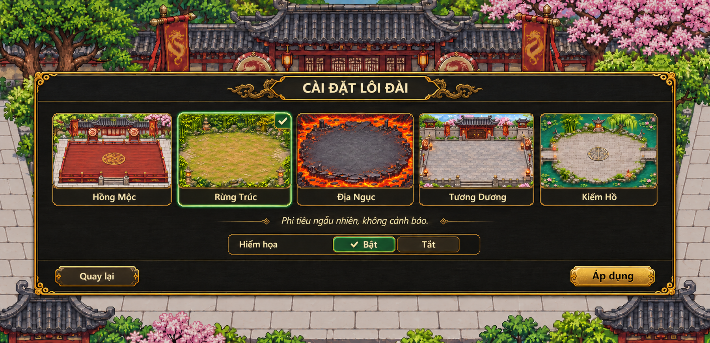

### 09 — HUD trận

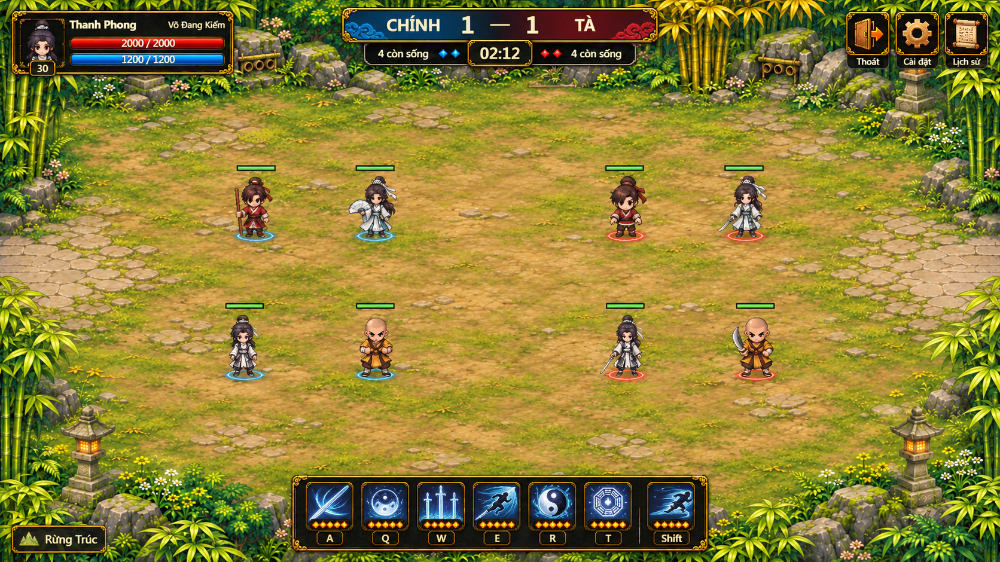

### 10 — Trạng thái trận

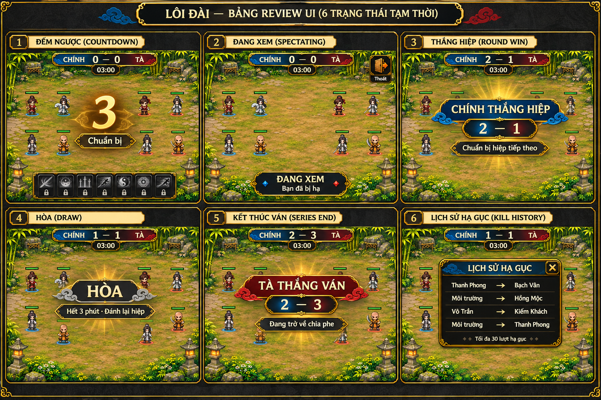

### 11 — Menu và vào phòng

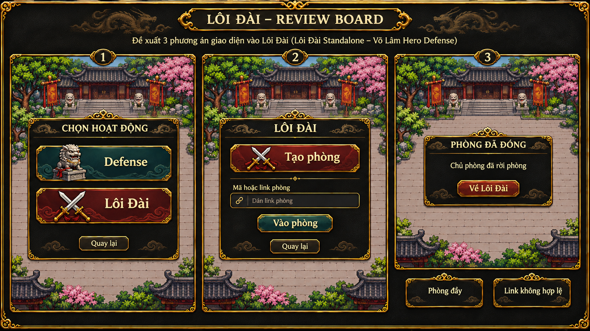
