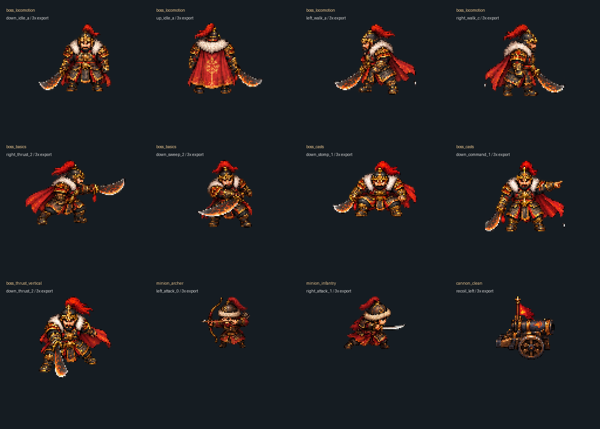
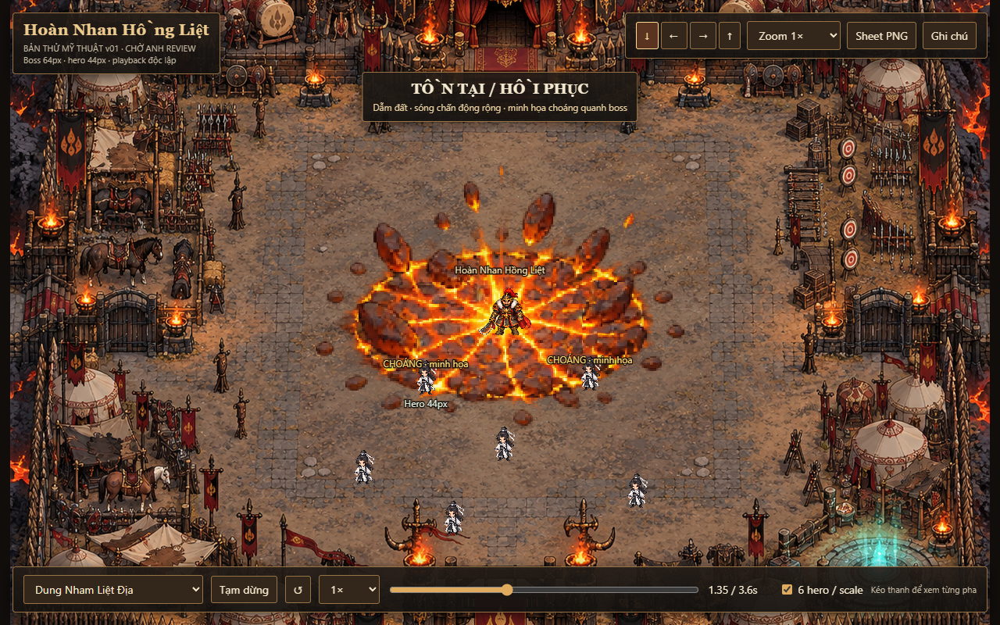
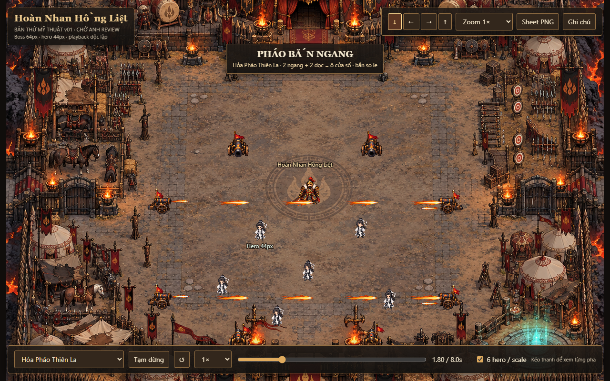

# So sánh mỹ thuật — prototype, chưa duyệt

Đã xem trực tiếp concept boss, quân Mông Cổ và đại bản doanh; positive Võ Đang, Hell, world/hub/battle/menu references; negative placeholder screenshot và negative dashboard thực trong `wuxia_town_world_reference.png`. Alias `vo_dang_art_direction_reference.png` không tồn tại; dùng `vo_dang_character_reference.png` theo inventory của dự án. File `current_codex_dashboard_anti_reference.png` thực chất là sheet Võ Đang, không phải dashboard.

| Mốc | Quan sát | Bộ thử |
| --- | --- | --- |
| Võ Đang positive | Đầu hơi lớn, mặt rõ, trang phục nhiều lớp, nét tối, cardinal facings | Boss giữ tỷ lệ chibi/đường nét tối, 4 hướng nhìn rõ; các attack candidate còn cần chỉnh hướng và pivot thủ công |
| Boss concept | Giáp đen/đồng, cổ lông sáng, áo choàng đỏ, đao nứt nham thạch | Đã giữ identity; gameplay sprite riêng, không cắt portrait/concept thành frame |
| Arena concept | Lều chỉ huy phía bắc, quân cụ ở viền, sân đất rộng, nham thạch ngoài hàng rào | Tái sử dụng nguyên ảnh để duyệt bố cục và scale; không nhận là tileset/map runtime |
| Hell positive | Nham thạch/đá basalt nhiều chi tiết, silhouette đọc trên nền nóng | VFX có rim đá/ash, nhưng warning và damage vẫn quá gần màu cam khi chồng |
| Placeholder negative | Hero hình hộp, cây/đất lặp, ít chất liệu | Bộ thử dùng PNG authored/generated thực, không Phaser Graphics hoặc geometry dựng sprite |
| UI / dashboard negative | Game nhỏ bên trái, cột ngoài bên phải | Preview một viewport lớn; mọi điều khiển là overlay có thể đóng, không có sidebar ngoài |

Ảnh trên là **Canvas art preview**, không phải ảnh game Phaser và không chứng minh stun/damage/synchronization. Sáu hero là mốc tỷ lệ. Tỷ lệ/chi tiết chỉ đang ở mức prototype; production còn phải tách environment, dọn cels lỗi, quan sát thời gian/transition/feet trong Phaser thật và được director duyệt.
