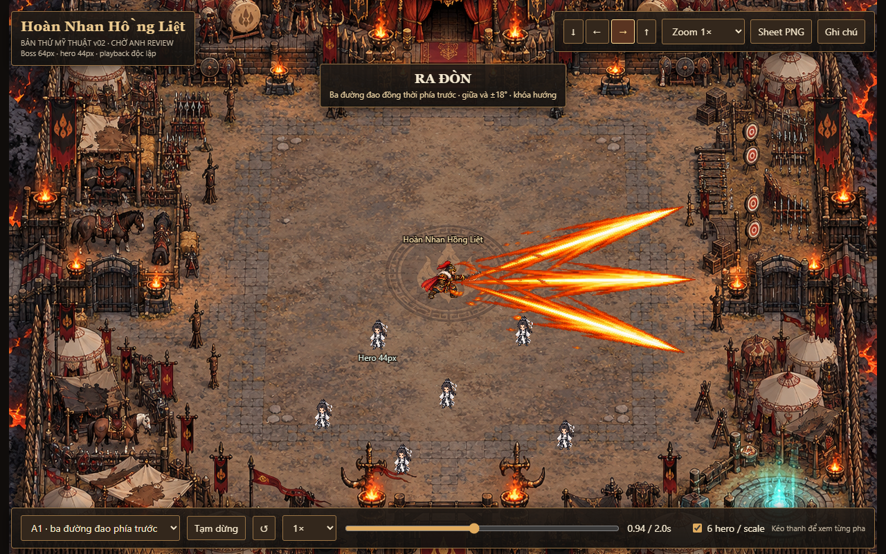
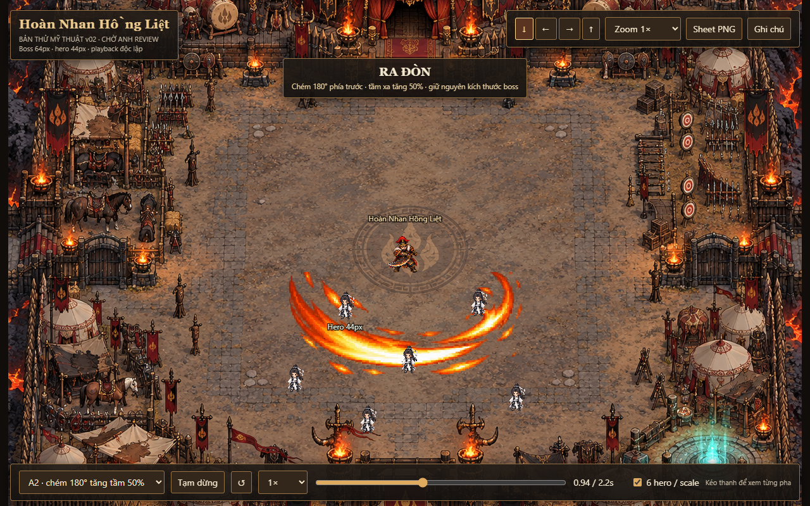
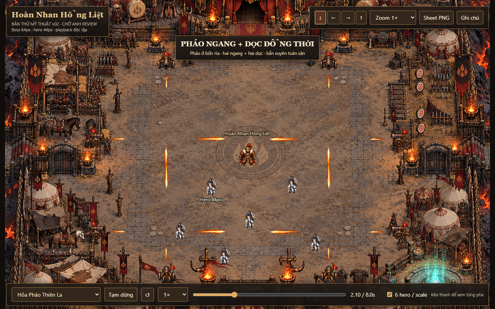

# Art preview v02 — A1, A2 và Hỏa Pháo Thiên La

Ngày 2026-11-01. Chỉ sửa playback mỹ thuật trong cùng worktree; chưa tích hợp Phaser.

## Yêu cầu mới của director

- A1: ba đường đao về phía trước, để khó né hơn.
- A2: tăng tầm xa.
- Hỏa Pháo Thiên La: ngang và dọc cùng lúc; đặt ở rìa và bắn xuyên suốt arena.

Bản thử dùng **ba hướng -18° / 0° / +18°**, **A2 tăng 50%**. Đây là thông số đề xuất để xem, chưa phải số balance được director chốt.

## Đã sửa

- A1 phát ba vệt đao đồng thời từ một điểm ra đòn; không phóng to boss. Giữ lấy đà/contact/hồi và khóa ba hướng theo hướng mặt.
- A2 vẫn là bán nguyệt 180° trước mặt, tăng scale tầm 1,5 lần và đặt lại pivot. Clip phần sau boss để không biến thành vòng 360°.
- Tám pháo đặt ở bốn rìa. Cả hai trục cảnh báo cùng lúc rồi khai hỏa cùng lúc. Hai làn ngang và hai làn dọc thành ô cửa sổ.
- Mỗi viên có thời điểm sinh và thời gian bay tới rìa đối diện. Không dùng loop teleport/đổi hướng giữa sân; ngừng sinh đạn trước, đợi đạn đang bay ra hết rồi thu pháo.
- Cấu hình playback nằm trong [choreography_v02.json](choreography_v02.json); bố trí đồng bộ với [arena_layout_v01.json](arena_layout_v01.json).
- Sprite/PNG/atlas nguồn không thay đổi. Tái sử dụng nguyên art để ghép đường đao và VFX; không generate lại boss/minion/environment.

## Xem

[Preview v02](http://127.0.0.1:5198/assets/reviews/bosses/hoan_nhan_hong_liet_v01/?v=2). Refresh trang nếu đang mở bản cũ.

## Kiểm tra thực tế

- `node --check .../review.js`: PASS.
- `node .../check_review_v02.cjs`: PASS_V02_STANDALONE_ONLY.
- A1: 3 vệt đồng thời, góc đối xứng, 4 hướng; warning/contact/fade.
- A2: 4 hướng, tăng tầm 1,5 lần, pivot/frontal clip.
- Pháo: 4 làn warning, 8 pháo ngoài rìa, 5 mốc khai hỏa đều có flash ở cả hai trục; kiểm tra đầu viên đến sát rìa đối diện <1px, hết lifetime không wrap, còn đạn sau khi ngừng sinh và cleanup cuối.
- Quan sát requestAnimationFrame thật trong 1,3 giây có cả hai trục và chuyển động >300px. Chi tiết số đo ở [browser_validation_v02.json](browser_validation_v02.json).
- Viewport 1280×800, 1920×1080 và 960×600. Console/page errors rỗng sau sửa. Có một lần đầu phát hiện thiếu khởi tạo pivot trong draw helper; đã sửa trước kết quả PASS.
- Không chạy Phaser/server/full-game suite vì chưa đổi game code. Không có video, GIF hoặc trace.

## Trạng thái duyệt và prompt integration

**A1/A2/Hỏa Pháo Thiên La v02 đang chờ director review lại.** Duyệt v01 được lưu nguyên trong `history/director_approval_22c4b803.json`; nhận diện boss và các art không bị sửa vẫn giữ scope duyệt trước đó.

Prompt integration gửi trước đây đã lỗi thời ở ba điểm. Khi tích hợp sau này, thay các yêu cầu cũ bằng:
1. A1 có ba đường đao hướng trước, không còn một làn đơn.
2. A2 phải tăng tầm; hệ số 1,5 hiện chỉ là bản thử.
3. Hỏa Pháo Thiên La khai hỏa ngang/dọc đồng thời từ bốn rìa, viên bay hết arena; không còn bắn hai trục so le.

Chưa bắt đầu integration. Các giới hạn minion attack, side cannon recoil và arena concept/tilemap của v01 vẫn còn như đã ghi, không tự được coi đã sửa bởi lần cập nhật này.
