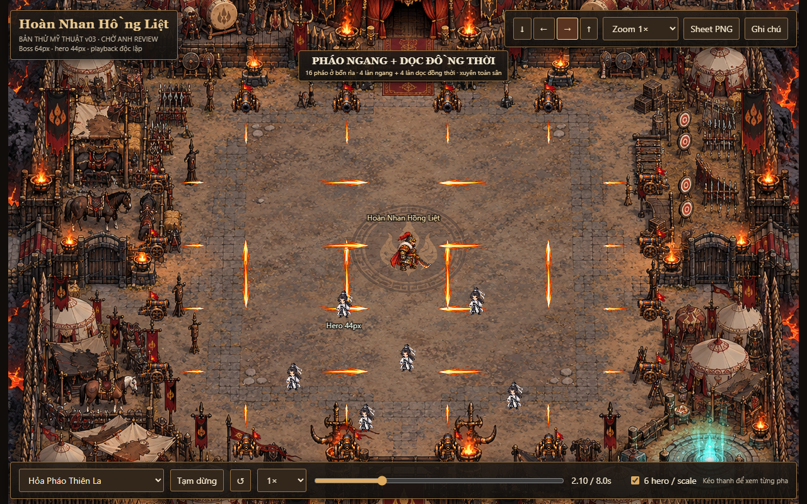
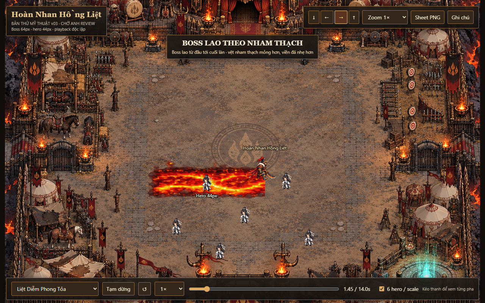
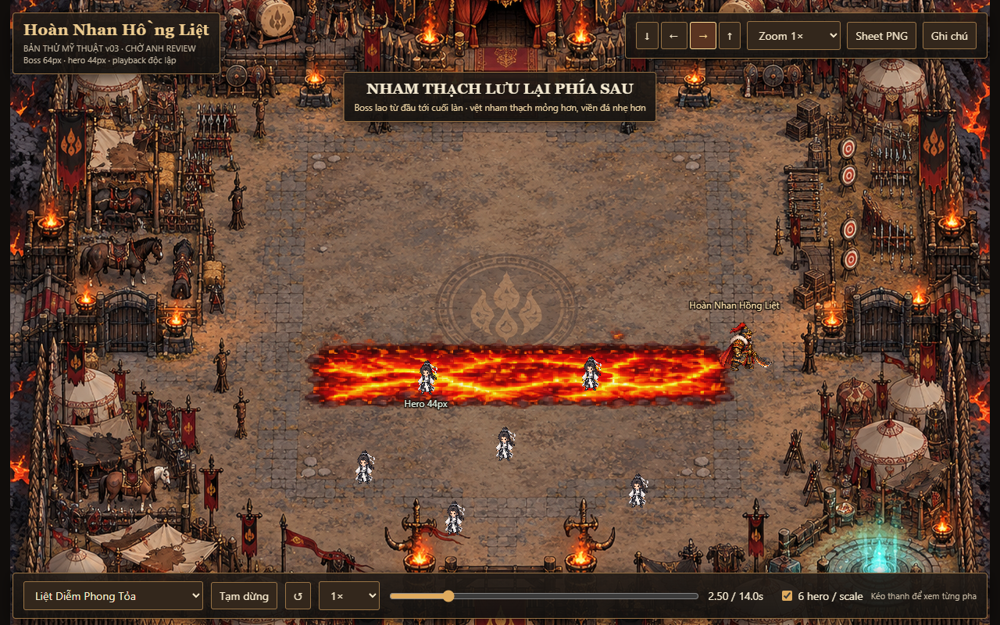

# Art preview v03 — thêm pháo và boss lao theo nham thạch

Ngày 2026-11-01. Branch `wip/m3d/hoan-nhan-hong-liet`. **Chưa tích hợp Phaser; đang chờ director review.**

## Thay đổi

- Hỏa Pháo Thiên La tăng từ **8 lên 16 khẩu**, bốn khẩu mỗi rìa: bốn làn ngang và bốn làn dọc, khai hỏa đồng thời, viên bay hết sân như v02.
- Liệt Diễm Phong Tỏa: cảnh báo đường → boss lao từ đầu tới cuối → để lại nham thạch dần sau chân → hồi thế tại đích → nham thạch tiếp tục tồn tại rồi nguội.
- Tốc độ lao thử: đi hết 550px ngang hoặc 450px dọc trong 0,8 giây; dùng bốn cel stride thật đã có với cadence 80ms. Đây là reuse sprite để duyệt chuyển động, chưa phải bộ pose dash chuyên biệt mới.
- Tách source `vfx_lava_lane_v03` qua built-in image_gen edit: bớt bờ đá và flare cao. Source cũ giữ nguyên. Bề dày render surface giảm từ scaleY 1,55 xuống 1,2 (khoảng 23%); không làm nhỏ boss.
- Làn warning vẫn báo toàn đường; vệt nóng chỉ hiện đến vị trí boss đã đi qua. Đường nham thạch đứng yên sau khi boss đến đích; không chạy theo boss.
- A1 ba đường và A2 tăng tầm của v02 giữ nguyên.

16 khẩu, cadence, thời gian lao và giảm độ dày là các lựa chọn thử cho yêu cầu tăng pháo/giảm hiệu ứng; chưa chốt balance.

## Xem

[Preview v03](http://127.0.0.1:5198/assets/reviews/bosses/hoan_nhan_hong_liet_v01/?v=3). Refresh nếu đang mở v02.

Cấu hình: [choreography_v03.json](choreography_v03.json). Source/prompt/thời điểm/tham chiếu: `assets/source/bosses/hoan_nhan_hong_liet_v01/generation.json`.
Xuất mới: `assets/exports/bosses/hoan_nhan_hong_liet_v01/vfx_lava_lane_v03.png` + JSON, tám cels.
Sử dụng lại exporter với `cuts()`; không vẽ nham thạch bằng Graphics/rectangles. Clip chỉ dùng để mở dần PNG authored theo quãng đường boss đã lao.

## Kiểm tra thực tế

- Exporter chạy thành công; các PNG/JSON atlas cũ byte-identical. Chỉ thêm source/atlas lava v03 và cập nhật inventory.
- `node --check .../review.js` và `.../check_review_v03.cjs`: PASS.
- `node .../check_review_v03.cjs`: **PASS_V03_STANDALONE_ONLY**, console/page errors rỗng.
- 16 pháo, 8 làn warning, cả hai trục bắn đồng thời tại năm mốc; mỗi viên đợt đầu tới cách rìa đối diện dưới 1px, cleanup cuối.
- Boss theo đúng đường ở bốn hướng tại năm mốc; warning không có lava nóng, vệt nóng không hiện vượt chân boss, giữ vị trí ở đích, nham thạch tồn tại/nguội/cleanup.
- Quan sát live requestAnimationFrame thấy đủ bốn stride cels và di chuyển hơn 450px. Số đo và thời gian: [browser_validation_v03.json](browser_validation_v03.json).
- PNG/atlas/alpha/hash/static bounds: [static_validation_v03.json](static_validation_v03.json).
- Viewport 1280×800, 1920×1080 và 960×600. PNG được xem trực tiếp để so sánh độ gọn viền và vị trí boss.
- Không chạy full-game suite hoặc Phaser playtest vì chưa sửa game code; không có damage/server collision/multiplayer acceptance. Không video, GIF hoặc trace.

## Khi tích hợp sau review

Yêu cầu Liệt Diễm mới thay phiên bản boss đứng yên vẩy làn: boss phải thực sự lao theo đường và để lại hazard phía sau; vị trí, collision, damage và lifetime phải do server quản lý.

Pháo dùng đội hình đông hơn; con số 16 hiện là trial. Giữ hai trục đồng thời và xuyên hết sân. Các phần A1/A2 đang chờ review từ v02 không được tự nâng thành đã duyệt.

Các hồ sơ/PNG v01 và v02 được giữ lại; bản ghi review hiệu lực nằm trong `director_approval.json`.
