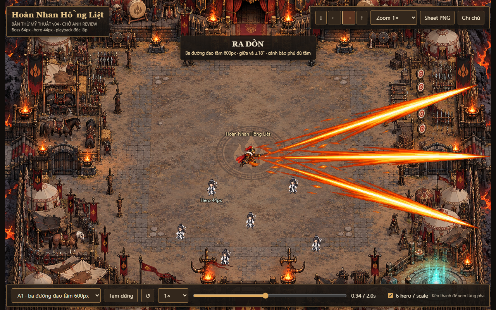
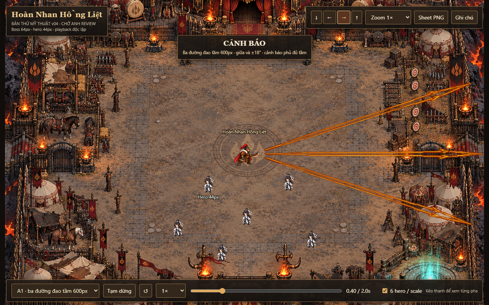

# Art preview v04 — kéo dài A1 để gây áp lực lên phái tay dài

Ngày 2026-11-01. Branch `wip/m3d/hoan-nhan-hong-liet`. **Chưa tích hợp Phaser; thông số đang chờ review.**

Yêu cầu director: đòn A1 cần xa hơn để phái tay dài phải né.

## Thay đổi

- Ba đường A1 dùng tầm thử **600px tính từ điểm phát vệt đao**, so với vệt peak cũ khoảng341px: tăng khoảng76%.
- Giữ ba hướng -18°/0°/+18°, độ dày, thời điểm lấy đà/ra đòn/hồi và kích thước boss.
- Dùng `reachPx` thay cho một scaleX cố định. Đo đầu mút opaque của từng cel PNG để warning và các pha VFX có cùng tầm600px; không chỉ kéo dài frame peak rồi để warning ngắn hơn.
- Không regenerate hoặc sửa pixel/atlas. Đây là stretch VFX theo tầm mong muốn, không phóng to actor.
- A2,16 pháo đồng thời và boss lao trên nham thạch nhẹ của v03 giữ nguyên.
- 600px là số thử, không phải balance đã duyệt. Dữ liệu cục bộ tham khảo có Võ Đang Kiếm Khí320px và Hàng Long Hỏa Vũ440px, nhưng chưa chạy simulation để kết luận mọi build ranged đều bị khắc chế.

## Xem

[Preview v04](http://127.0.0.1:5198/assets/reviews/bosses/hoan_nhan_hong_liet_v01/?v=4). Chọn A1 và hướng phải để xem trọn chiều dài ở normal zoom; có thể dùng zoom Toàn arena để quan sát vệt dài theo hướng dọc.

Cấu hình [choreography_v04.json](choreography_v04.json). Đường đi trên ảnh concept không phải bằng chứng collision/line-of-sight; khi tích hợp phải để server quyết định reach/hit/terrain, client chỉ trình bày.

## Kiểm tra thực tế

- `node --check .../review.js`, `.../check_review_v04.cjs`: PASS.
- `node .../check_review_v04.cjs`: **PASS_V04_STANDALONE_ONLY**.
- Đọc alpha>180 của PNG thật độc lập, đo đầu mút bốn cels; xác nhận độ dài vệt600px tại20 mẫu (bốn hướng, warning/contact/fade).
- Ba vệt đồng thời; độ dày1,15 và spread±18° giữ nguyên; actor scale1; effect cleanup tại1,4s.
- Quan sát live thấy đủ bốn VFX cels và cleanup. Một assertion ban đầu giả định vệt luôn còn trong toàn cửa sổ quan sát đã được sửa để kiểm tra đúng thời điểm expiry, không đổi timing của chiêu.
- Kiểm tra giữ16 pháo, lava dash/lighter effect và A2x1,5; viewport1280×800,1920×1080,960×600; console/page errors rỗng.
- Số đo tại [browser_validation_v04.json](browser_validation_v04.json). Các hash art giữ nguyên được kiểm tra.
- Không chạy game-core/server/full-game suite hoặc Phaser playtest vì chỉ sửa art review; không có video/GIF/trace.

Khi tích hợp sau này, A1 phải có authoritative reach tương ứng; kéo dài sprite đơn thuần không tạo threat lên phái tay dài trong combat thật.
