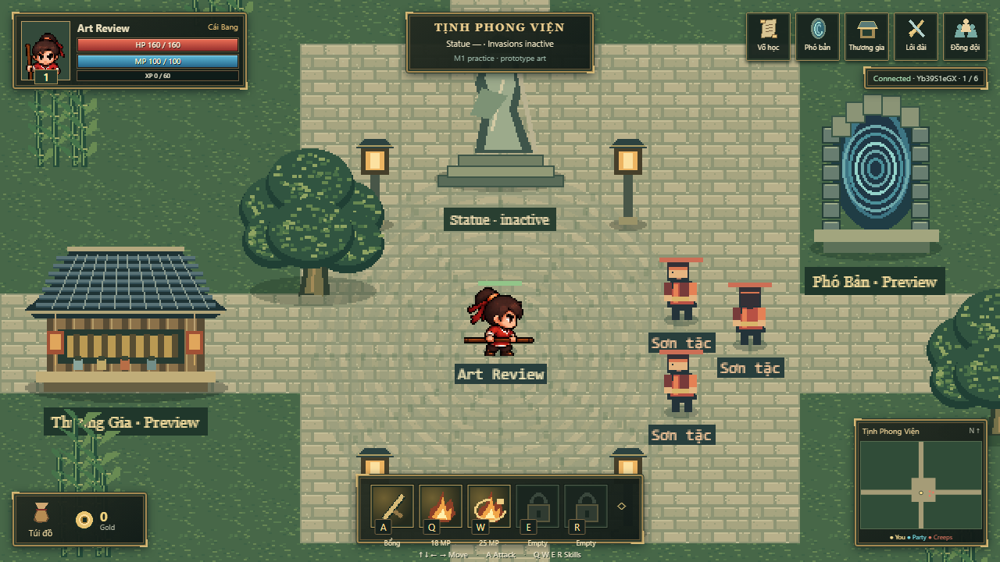
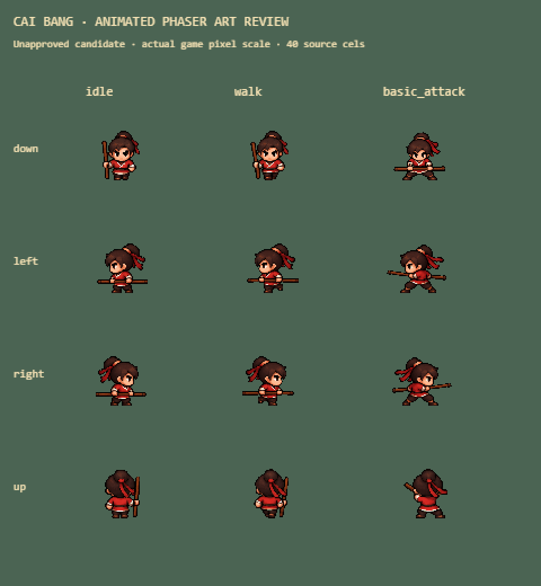
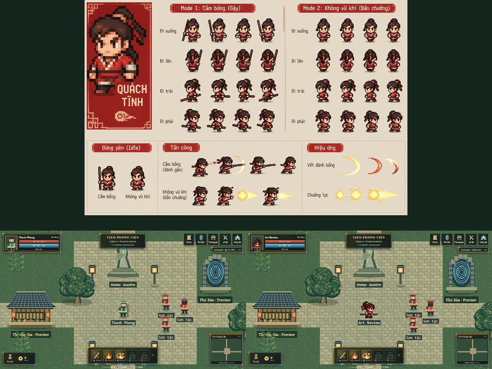

# Cái Bang v1.6 — director visual review

**NEEDS REVISION / awaiting explicit director approval.** Only the single Cái Bang hero was produced and integrated. No environment, creep, UI architecture, combat, networking, controls or game-rule change is claimed. Technical passes do not establish art approval.

## Actual-run evidence

- `gameplay_1280x720.png`: real joined match, normal camera zoom 1 and 2× integer display scale; world and existing HUD occupy the viewport.
- `gameplay_1920x1080.png`: real joined match at the larger viewport, same 2× display scale.
- `six_players_1280x720.png`: six separate browser contexts in the same actual room, with real arrow-key movement and six hero sprites confirmed in the local renderer.
- `walk_*_1280x720.png`, `idle_*_1280x720.png`, `attack_*_1280x720.png`: all four facings captured after real arrow/A keyboard inputs, not injected animation states.
- `phaser_animation_preview.gif`: 30 captured frames of the running Phaser review gallery, approximately 6 seconds, 960×1040 at the same 2× display scale. Screenshot file times determine GIF cadence; it is not generated video or a concept animation. Every frame of all 12 authored animation tags was observed during capture.
- `phaser_animation_gallery.png`: still capture from that gallery.
- `logical_canvas_640x360.png`: native logical world view recovered by nearest-neighbour 2:1 sampling of the lossless 1280×720 canvas-only capture (`canvas_2x.png`). This is a documented derivative, not a separately captured match with a different zoom.
- `match-capture.json`, `animation-capture.json`: actual browser observations and empty page-error lists. Raw gallery screenshots are under ignored `artifacts/cai_bang_v1_6/`.

## Reference comparison

`reference_before_after.png` places the actual Cái Bang concept above the old negative screenshot (bottom left) and this new gameplay screenshot (bottom right). The two gameplay views are reduced equally for comparison; judge full-resolution captures for normal-zoom acceptance.

| Target | Observed result / remaining difference |
|---|---|
| Cái Bang reference: large expressive head, dark bangs/ponytail/red ties, red layered tunic, pale collar/wraps, dark boots, wooden staff | New source art follows these features. It replaces the green rectangular placeholder. Small highlights and facial clusters are visible at normal 2× display scale. Side poses use a horizontal staff carry; front/back carry it upright. |
| Four-direction motion with coherent weapon/feet | Real alternate leg poses and staff anticipation/strike/recovery exist. All 40 atlas poses are distinct; Aseprite retains a common foot pivot. Right-facing art mirrors the left sequence. Low frame count, slight generated ribbon/costume variation, and different front-attack source shading remain review points; this is not claimed to be hand-finished production art. |
| Coherent attack pose in each facing | Front attack is a forward/downward smash, side attacks thrust/sweep, back attack raises/strikes away. Existing server damage and pose timing remain unchanged; art does not move or enlarge the hit sector. |
| Full hub/battle/town visual quality | Not reached by this scoped request. `central_arena_hub_reference.png` and the detailed town actually in `in_game_world_reference.png` still exceed the unchanged environment in richness, shading and prop variety. `wuxia_town_world_reference.png` is mislabeled and contains the old dashboard. |
| Latest anti-reference | Hero silhouette/costume/animation are now materially different from its primitive hero. Terrain, buildings, foliage, creeps, effects and UI textures remain visibly the old placeholders. No full ART-01 environment completion is claimed. |

Cast reuses staff frames; hurt/death reuse idle frames as explicit presentation fallbacks. Those three animation sets were not produced in this task and must not be counted as finished art.

## Commands actually run

| Check | Result |
|---|---|
| Aseprite `--version`, `--help` | Verified `C:\Program Files\Aseprite\Aseprite.exe`, version `1.3.18.6-x64`; batch/script/sheet/tag/slice options available |
| `node scripts/export-cai-bang.mjs --assemble` | PASS: editable Aseprite source, 40 cels, 12 correct tag ranges, 800×320 PNG, JSON hash metadata and pivot slice |
| `pnpm typecheck` | PASS after integration and final browser-test additions |
| `pnpm test` | PASS: 6 test files, 62 unit/integration tests |
| `pnpm verify:assets` | PASS: 16 runtime PNG assets; 168 animation frame references; hero dimensions, alpha, unique poses, tags and pivot verified |
| `pnpm test:e2e` | PASS: production build and all 12 Chromium tests, including real four-direction input captures, all authored tag playback, two-client authoritative combat/progression, camera/occlusion, lobby and UI smoke checks |
| `node tools/run-playwright.mjs test tests/e2e/cai-bang-art.spec.ts` | PASS: all 3 targeted art tests after adding the six-player capture (two repeated character checks plus one new six-player check) |
| Targeted `--grep 'six Cái'` capture rerun | Final PASS after replacing latency-sensitive held movement with short feedback-controlled keyboard taps; all six heroes positioned together. The first positioning attempt overshot and failed; no game logic was changed to resolve it. |
| Prettier on changed TS/CSS/JS | PASS after formatting the new capture spec |

The production build retains its existing large-chunk advisory. No missing texture/frame or browser page errors were observed. User-edited v1.6 specifications and supplied reference files were not rewritten by this task.

## Approval boundary

Review the full-size screenshot and animated preview. Explicit director approval is required before creating other schools or environment art. Record approval only after it is actually given; until then retain `prototype` and `NEEDS REVISION`.
