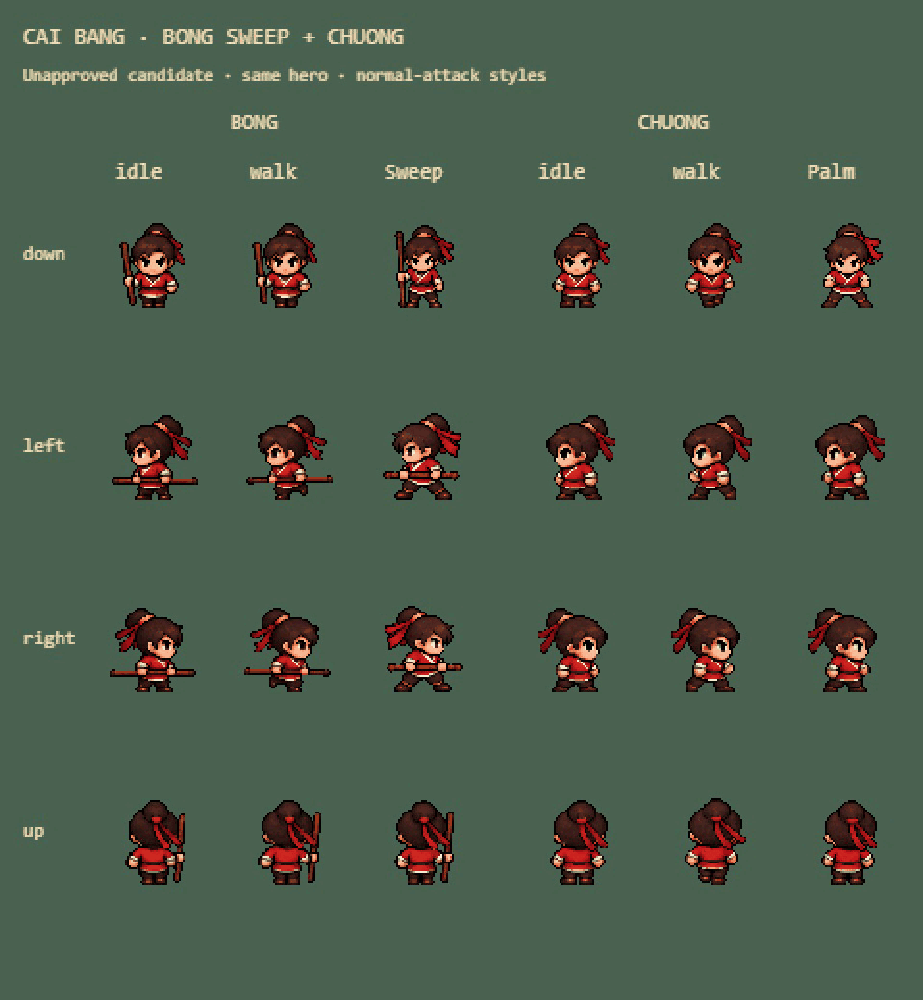
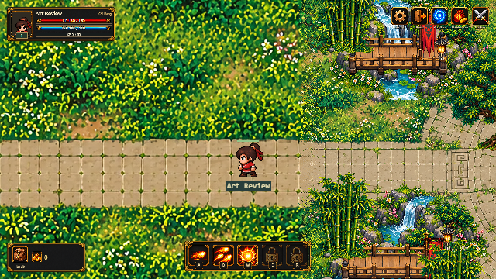

# Cái Bang refinement — Bổng sweep and Chưởng

**Status: prototype / awaiting director visual approval.** The director's "almost good" feedback authorized these two revisions of the same Cái Bang hero; it did not approve expansion to other schools or environments.

## Delivered art and runtime behavior

| Style | Editable source | Runtime atlas | Authored animation tags |
|---|---|---|---|
| Bổng | `assets/source/characters/cai_bang_v1_6/hero_cai_bang.aseprite` | `assets/exports/characters/hero_cai_bang.png` + JSON; 800×400; **44 cels** | Four-direction idle (2), walk (4); basic attack **6 frames left/right**, 4 down/up |
| Chưởng | `assets/source/characters/cai_bang_v1_6/hero_cai_bang_chuong.aseprite` | `assets/exports/characters/hero_cai_bang_chuong.png` + JSON; 800×320; **40 cels** | Four-direction unarmed idle (2), walk (4), open-palm attack (4) |

Both retain 80×80 transparent frame canvases, approximately 44px character bodies and foot pivot `(40,64)` / `(0.5,0.8)`. Right-facing poses mirror left. Staff side attacks now rotate the weapon through diagonal, vertical, opposing diagonal and horizontal follow-through poses, with torso/arm changes; they do not extend into a linear end-first lunge. Six 50ms poses retain the previous 300ms presentation duration.

The existing replicated `basicId` selects the world texture. Existing portrait/paper-doll slots and the A icon follow the same selection. Chưởng has no staff in idle, walk, attack or recovery. Fire projectile/impact textures, projectile auto-aim/straight flight, input controls, damage/collision, cooldowns, multiplayer and UI architecture are unchanged.

Chưởng firing can turn the hero toward the nearest enemy under the existing server rules. Therefore an attack after moving down need not use the down-facing pose. `chuong-capture.json` records movement, authoritative facing and rendered pose. The separate live Phaser gallery demonstrates all four palm directions.

## Actual-run evidence

- `phaser_animation_preview.webm`: continuous Playwright recording of the running Phaser review, 960×1040 at the usual 2× display scale. No animation frames were synthesized by video generation.
- `phaser_animation_preview.gif`: six-second loop mechanically decoded from that video at 20fps with a fixed 128-color preview palette. Use the WebM or live page for the original capture colors.
- `phaser_animation_gallery.png`: actual still of Bổng and Chưởng side by side. The preview URL remains `http://127.0.0.1:5173/?artPreview=1&caiBangReview=1`.
- `animation-capture.json`: all **24 authored tags** observed, including all six frames of both Bổng sweeps.
- `walk_*`, `idle_*`, `attack_*_1280x720.png`: revised Bổng in actual joined matches using arrow/A input.
- `chuong_walk_*`, `chuong_idle_*`, `chuong_attack_after_*_1280x720.png`: real selected Chưởng movement/combat captures. Live hurt feedback and correct scenery/enemy occlusion may interrupt or cover a pose during a still capture; the continuous gallery isolates animation review.
- `gameplay_1280x720.png`, `gameplay_1920x1080.png`, `six_players_1280x720.png`, associated JSON: actual match/normal-zoom and six-client captures.

## Source and review limits

Original source poses came from the built-in OpenAI image generator, with the existing candidate and director concept used as identity/design references. No concept-sheet pixels were cropped into animation frames. Saved prompts are `prompts_v2.json` and `sweep_correction_prompt.json`; generated PNGs and measured bounds are preserved alongside the editable sources. Aseprite assembled and exported the real source cels, tags, pivot slice, PNGs and JSON. The initial Bổng editable source is preserved at `revisions/bong_v1.aseprite`.

Compare the red costume, pale wraps/collar, dark ponytail/red ribbons, silhouette and palm/weapon separation against `assets/references/cai_bang_character_reference.png`. Minor generated costume/shading differences and low frame counts remain visual review points. Cast/hurt/death reuse poses and are not newly authored sets. Creeps, terrain, scenery, UI frames and fire VFX remain the old placeholders. This does not claim completion of the wider ART-01 environment slice.

## Verification actually run

- `node scripts/export-cai-bang.mjs --assemble`: PASS, 44 Bổng cels / 12 tags.
- `node scripts/export-cai-bang.mjs --chuong --assemble`: PASS, 40 Chưởng cels / 12 tags.
- `pnpm typecheck`: PASS.
- `pnpm test`: PASS, **62 unit/integration tests** in 6 files.
- `pnpm verify:assets`: PASS, **17 runtime asset entries**, 248 frame references; both atlases' dimensions, nonempty poses, tags, bounds, binary alpha and pivots validated.
- `pnpm test:e2e`: production build passed; **13 browser tests passed**, including the combined preview, Bổng captures, six-client readability, camera/occlusion, two-client combat/progression and replicated Chưởng texture selection, straight projectiles, lobby and UI checks. The new Chưởng capture test initially assumed attack facing equals movement facing, then assumed a hit cannot interrupt the pose during screenshot capture. Those assumptions were corrected to preserve real auto-aim and hurt behavior.
- `node tools/run-playwright.mjs test tests/e2e/cai-bang-art.spec.ts --grep 'Chưởng normal'`: final **PASS** for the corrected Chưởng test, covering four walking/idle facings, actual palm attack activation, server-reported facing, portrait/icon selection and return to Bổng.
- Prettier on changed TS/CSS/JS and `git diff --check`: PASS.

No `game-core`, server, map or unrelated environment/VFX texture change was needed. The existing production build large-chunk advisory remains.

## Approval

Review both styles and especially the left/right staff rotation at normal playback speed. Both stay `prototype / NEEDS REVISION` until explicit director approval. No other school or environment art was produced.
