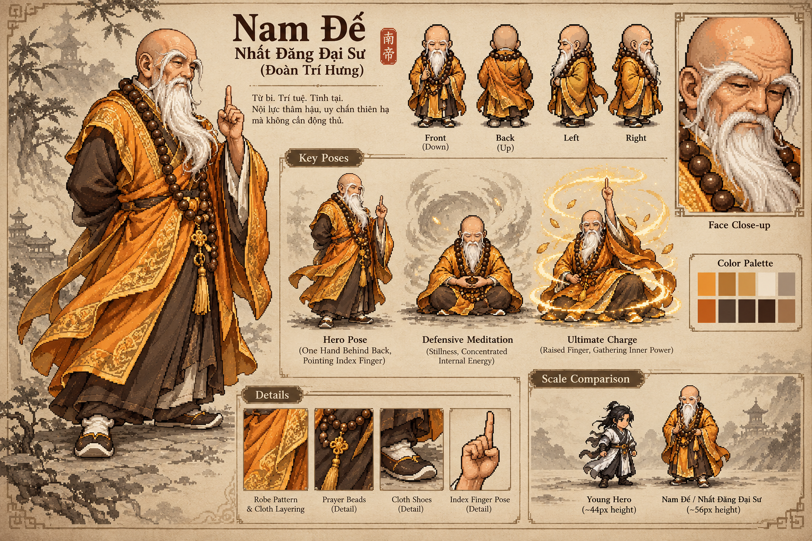
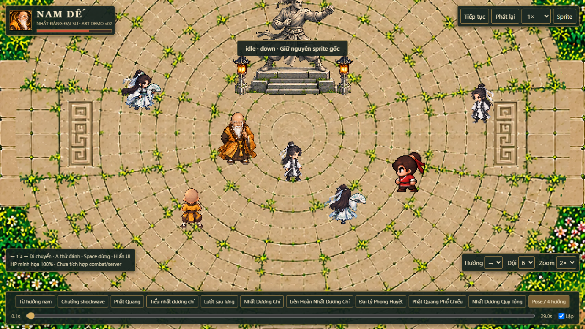
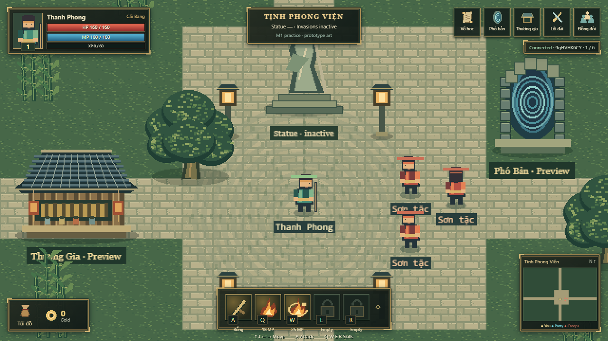

> Feedback03 (2026-11-02): the accepted cadence and slow turn now emit four simultaneous directions per volley. Each lane retains its 0.9s warning; volleys remain 0.8s apart and a turn remains 12.8s. Current six-witness PNGs, assertions and the successful final pipeline are under `evidence/feedback03/`. Original rasters are unchanged.

> Feedback02 (2026-11-02): Liên Hoàn now turns slowly, warns each lane for 0.9s and fires sixteen rays sequentially at 0.8s intervals. The pressure-point dialog closes immediately on success or wrong input while the world VFX continue. Latest live evidence and the successful final pipeline are in `evidence/feedback02/`. Prior comparisons below remain historical.

> Feedback01 (2026-11-02): the latest preview replaces the ornate normal Phật Quang with one plain ring, adds explosion/stun after a wrong pressure-point input, covers the full circle with Liên Hoàn volleys and releases the small ray instantly. Current evidence is `evidence/feedback01/`; the screenshots and observations below remain the historical initial v02 review. Exact current behavior/defaults: README.md.

# Nam Đế v02 — actual Phaser review

**Status: PROTOTYPE / PENDING DIRECTOR REVIEW.** Reused actor and concept bytes, original gold VFX plus sixteen newly authored VFX cels and four shaft crops. No gameplay boss/server integration or automatic approval.

Read the design handoff, art/UI standards, v01 Nam Đế inventory, production/iteration and development workflows. Visually inspected the actual Nam Đế master concept, actor atlas and effect PNGs, Võ Đang style reference, full-world reference, central hub/battle/dungeon/menu reference set and placeholder anti-reference. The old `vo_dang_art_direction_reference.png` alias is absent; its documented replacement `vo_dang_character_reference.png` was used. `current_codex_dashboard_anti_reference.png` actually contains a character sheet, as the reference inventory notes.

## Screenshot comparison

| Retained positive direction | Actual normal-zoom Phaser render | Rejected placeholder benchmark |
| --- | --- | --- |
|  |  |  |

The retained elderly monk has the saffron layered robe, beads, bald head and long ivory beard of the concept. Native body height remains approximately 56px against approximately 44px heroes. Actual cel animation replaces the rejected block-person presentation. Normal 2× rendering uses nearest sampling, a fixed feet origin and the existing orthogonal main arena. The court is deliberately open for combat; the reference's richer perimeter composition is not newly authored by this task.

All review controls and the pressure-point/arrow-remap overlays remain inside the full viewport, rather than consuming a permanent exterior column. The review dock is a tool for choosing animations, not proposed final gameplay HUD artwork.

## Inspected effects and corrections

- `evidence/nhat-duong-chi.png`: active ray now starts at the retained extended fingertip pose. The initial prototype over-stretched a full padded atlas cel backward across the boss. It was corrected by cropping only original shaft pixels and scaling by the actual texture width. Neighboring charge/ground fragments in the v01 ray cel are excluded from the derivative; original files stay intact.
- `evidence/dai-ly-phong-huyet.png`: boss reaches contact, a pressure seal marks the protected victim, ten arrow keys and countdown stay readable. The interaction test covers success, one wrong key, freeze, illustrative immunity and five-second expiry.
- `evidence/phat-quang-pho-chieu.png`: light is centered on one victim, with a separate gold/cyan orbit above the head. This deliberately replaces the old healing visual interpretation; there is no group healing formation.
- `evidence/nhat-duong-quy-tong.png`: one upward launch precedes thirty-two individually warned downward shafts. Several shafts can coexist without covering the full map in a single white flash.
- `evidence/palm-shockwave.png`: a broad authored palm-energy front travels straight far enough to threaten the distant witness.
- `evidence/sprite-native-1x.png` and `sprite-native-2x.png`: actual native/normal display comparison. Six witnesses are independent local visual actors, not six connected clients.

## Acceptance boundary

Actual Phaser 4.2.1 AnimationManager playback observed all 208 retained actor cels / 52 four-direction clips and all sixteen new effect cels. Separate timeline samples exercised the entrance, three normals, dash and five specials. Wall-clock playback, pause, frame selection, target snapshots, QTE input/remapping and viewport bounds were checked in a real browser, with no page/load errors. See `evidence/verification.json` for exact scope and frame names.

The retained source poses have short four-cel clips. Rapid-fire hand/socket continuity across every facing and artistic transition quality remain director-review items; observing frames is not proof of final production polish. Numeric combat balance, real collisions/hits, network replication, six-client natural combat, statue targeting and actual wave scheduling are not exercised by this standalone preview. Those require a separately authorized authoritative encounter integration.

Source/provenance and atlas/cel hashes are in `manifest.json`, `generation_prompt.json` and `ray_derivation.json`. PNG screenshots and frame observations only; no recording was created.
