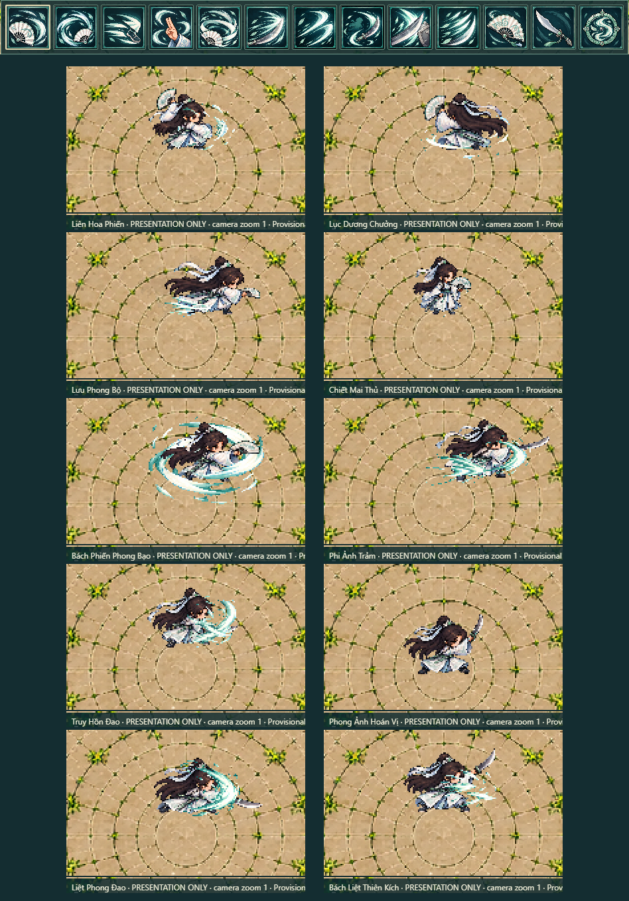

# Thiên Sơn skill art v01

**All concepts approved. Production assets are prototypes awaiting explicit final art approval.**

[Open the live art-only preview](http://127.0.0.1:5194/?artPreview=1&thienSonSkills=1) · [Visual review index](index.html) · [Coverage JSON](../../../exports/skills/thien-son/coverage_manifest_v01.json) · [Verification](verification_report_v01.json)

The overview composes cropped actual Phaser screenshots without rescaling. Camera zoom1, normal display scale2; approximately44px logical body and64 CSS-pixel icons. All ten active skills were also composed in all four facings under [all_facings/](all_facings/verification_v01.json).

| Stable ID / Vietnamese name | Approved concepts | Character animation | VFX | Icon | Export / Phaser | Gameplay | Final art approval |
|---|---|---|---|---|---|---|---|
| lien_hoa_phien — Liên Hoa Phiến | [Concept](../../../concepts/skills/thien-son/lien_hoa_phien-concept-v01.png) / [icon concept](../../../concepts/skills/thien-son/lien_hoa_phien-icon-concept-v01.png) | [New16 poses](../../../exports/skills/thien-son/lien_hoa_phien/lien_hoa_phien_character.animations.json) | [Wind stages](../../../exports/skills/thien-son/lien_hoa_phien/lien_hoa_phien_vfx.animations.json) | [64px PNG](../../../exports/skills/thien-son/lien_hoa_phien/icon.png) | PASS / PASS preview | Pending | Pending |
| luc_duong_chuong — Lục Dương Chưởng | [Concept](../../../concepts/skills/thien-son/luc_duong_chuong-concept-v01.png) / [icon concept](../../../concepts/skills/thien-son/luc_duong_chuong-icon-concept-v01.png) | [New16 poses](../../../exports/skills/thien-son/luc_duong_chuong/luc_duong_chuong_character.animations.json) | [Wind stages](../../../exports/skills/thien-son/luc_duong_chuong/luc_duong_chuong_vfx.animations.json) | [64px PNG](../../../exports/skills/thien-son/luc_duong_chuong/icon.png) | PASS / PASS preview | Pending | Pending |
| luu_phong_bo — Lưu Phong Bộ | [Concept](../../../concepts/skills/thien-son/luu_phong_bo-concept-v01.png) / [icon concept](../../../concepts/skills/thien-son/luu_phong_bo-icon-concept-v01.png) | [New16 poses](../../../exports/skills/thien-son/luu_phong_bo/luu_phong_bo_character.animations.json) | [Wind stages](../../../exports/skills/thien-son/luu_phong_bo/luu_phong_bo_vfx.animations.json) | [64px PNG](../../../exports/skills/thien-son/luu_phong_bo/icon.png) | PASS / PASS preview | Pending | Pending |
| chiet_mai_thu — Chiết Mai Thủ | [Concept](../../../concepts/skills/thien-son/chiet_mai_thu-concept-v01.png) / [icon concept](../../../concepts/skills/thien-son/chiet_mai_thu-icon-concept-v01.png) | [New16 poses](../../../exports/skills/thien-son/chiet_mai_thu/chiet_mai_thu_character.animations.json) | [Wind stages](../../../exports/skills/thien-son/chiet_mai_thu/chiet_mai_thu_vfx.animations.json) | [64px PNG](../../../exports/skills/thien-son/chiet_mai_thu/icon.png) | PASS / PASS preview | Pending | Pending |
| bach_phien_phong_bao — Bách Phiến Phong Bạo | [Concept](../../../concepts/skills/thien-son/bach_phien_phong_bao-concept-v01.png) / [icon concept](../../../concepts/skills/thien-son/bach_phien_phong_bao-icon-concept-v01.png) | [New16 poses](../../../exports/skills/thien-son/bach_phien_phong_bao/bach_phien_phong_bao_character.animations.json) | [Wind stages](../../../exports/skills/thien-son/bach_phien_phong_bao/bach_phien_phong_bao_vfx.animations.json) | [64px PNG](../../../exports/skills/thien-son/bach_phien_phong_bao/icon.png) | PASS / PASS preview | Pending | Pending |
| phi_anh_tram — Phi Ảnh Trảm | [Concept](../../../concepts/skills/thien-son/phi_anh_tram-concept-v01.png) / [icon concept](../../../concepts/skills/thien-son/phi_anh_tram-icon-concept-v01.png) | [New16 poses](../../../exports/skills/thien-son/phi_anh_tram/phi_anh_tram_character.animations.json) | [Wind stages](../../../exports/skills/thien-son/phi_anh_tram/phi_anh_tram_vfx.animations.json) | [64px PNG](../../../exports/skills/thien-son/phi_anh_tram/icon.png) | PASS / PASS preview | Pending | Pending |
| truy_hon_dao — Truy Hồn Đao | [Concept](../../../concepts/skills/thien-son/truy_hon_dao-concept-v01.png) / [icon concept](../../../concepts/skills/thien-son/truy_hon_dao-icon-concept-v01.png) | [New16 poses](../../../exports/skills/thien-son/truy_hon_dao/truy_hon_dao_character.animations.json) | [Wind stages](../../../exports/skills/thien-son/truy_hon_dao/truy_hon_dao_vfx.animations.json) | [64px PNG](../../../exports/skills/thien-son/truy_hon_dao/icon.png) | PASS / PASS preview | Pending | Pending |
| phong_anh_hoan_vi — Phong Ảnh Hoán Vị | [Concept](../../../concepts/skills/thien-son/phong_anh_hoan_vi-concept-v01.png) / [icon concept](../../../concepts/skills/thien-son/phong_anh_hoan_vi-icon-concept-v01.png) | [New16 step/guard +16 approved counter cels](../../../exports/skills/thien-son/phong_anh_hoan_vi/phong_anh_hoan_vi_character.animations.json) | [Wind stages](../../../exports/skills/thien-son/phong_anh_hoan_vi/phong_anh_hoan_vi_vfx.animations.json) + shared close slash | [64px PNG](../../../exports/skills/thien-son/phong_anh_hoan_vi/icon.png) | PASS / PASS preview | Pending | Pending |
| liet_phong_dao — Liệt Phong Đao | [Concept](../../../concepts/skills/thien-son/liet_phong_dao-concept-v01.png) / [icon concept](../../../concepts/skills/thien-son/liet_phong_dao-icon-concept-v01.png) | [New15 +1 approved windup](../../../exports/skills/thien-son/liet_phong_dao/liet_phong_dao_character.animations.json) | [Wind stages](../../../exports/skills/thien-son/liet_phong_dao/liet_phong_dao_vfx.animations.json) | [64px PNG](../../../exports/skills/thien-son/liet_phong_dao/icon.png) | PASS / PASS preview | Pending | Pending |
| bach_liet_thien_kich — Bách Liệt Thiên Kích | [Concept](../../../concepts/skills/thien-son/bach_liet_thien_kich-concept-v01.png) / [icon concept](../../../concepts/skills/thien-son/bach_liet_thien_kich-icon-concept-v01.png) | [New16 poses](../../../exports/skills/thien-son/bach_liet_thien_kich/bach_liet_thien_kich_character.animations.json) | [Wind stages](../../../exports/skills/thien-son/bach_liet_thien_kich/bach_liet_thien_kich_vfx.animations.json) | [64px PNG](../../../exports/skills/thien-son/bach_liet_thien_kich/icon.png) | PASS / PASS preview | Pending | Pending |
| thien_son_phien — Thiên Sơn Phiến | [Concept](../../../concepts/skills/thien-son/thien-son-basic-passive-icons-concept-v02.png) / [icon concept](../../../concepts/skills/thien-son/thien_son_phien-icon-concept-v01.png) | [Approved basic clip reused](../../../exports/characters/hero_thien_son.json) | Not applicable | [64px PNG](../../../exports/skills/thien-son/thien_son_phien/icon.png) | PASS / PASS preview | Pending | Pending |
| thien_son_dao — Thiên Sơn Đao | [Concept](../../../concepts/skills/thien-son/thien-son-basic-passive-icons-concept-v02.png) / [icon concept](../../../concepts/skills/thien-son/thien_son_dao-icon-concept-v01.png) | [Approved basic clip reused](../../../exports/characters/hero_thien_son_dao.json) | Not applicable | [64px PNG](../../../exports/skills/thien-son/thien_son_dao/icon.png) | PASS / PASS preview | Pending | Pending |
| bac_minh_than_cong — Bắc Minh Thần Công | [Concept](../../../concepts/skills/thien-son/thien-son-basic-passive-icons-concept-v02.png) / [icon concept](../../../concepts/skills/thien-son/bac_minh_than_cong-icon-concept-v01.png) | Not applicable; context idle only | Not applicable | [64px PNG](../../../exports/skills/thien-son/bac_minh_than_cong/icon.png) | PASS / PASS preview | Pending | Pending |

Visual assets verified in preview; gameplay implementation pending. No damage, cooldown, costs, hitboxes, movement rules, status effects, loadouts or authoritative simulation were added or changed. The13-icon strip is an asset review palette, not a new combat hotbar. Six displayed actors are presentation replicas, not a six-client benchmark.

Twenty character/VFX components provide146 tags and534 exported cels. This includes159 new character pose cels,100 new Wind source cels,17 reused approved character cels,48 within-skill semantic character reuses,192 exact cardinal Wind variants and18 expiry-stage reuses. All13 production icons derive from the explicitly approved icon art with4-to-1 Aseprite nearest reduction; no new icon motifs were invented.

Character bodies retain approximately44px height, feetY64 and origin(0.5,0.8). Canvases are80–128px wide by80px high for transparent cloth/blade clearance. VFX use96/128/160px canvases and recorded relative origins/offsets. The fixed overworld view and world foot point are unchanged. Wrapping rings/helix render a rear upper half and foreground lower half so faces remain clear.

Normal fan/đao clips remain the approved files. Liệt Phong Đao reuses one approved down-facing windup instead of the cropped draft blade. Phong Ảnh Hoán Vị reuses the approved four-facing dao attack for the conditional counter and Phi Ảnh Trảm’s local slash Wind. Counter and expiry are separate preview branches; the passive has no aura.

Actual final verification: typechecks,2 workflow tests,174 unit/integration tests, build, all asset validators and five unique browser scenarios passed across the full pipeline and focused fixture rerun. The full pipeline first ended with4/5 browser cases passing: the existing two-client test required the existing legacy Q/W development fixture. Correcting only those test flags made its focused rerun pass. An intermediate retry encountered another task’s frontend port; it was not borrowed or stopped, and the dedicated test frontend moved to5196. All test flags are process-local and restored. See verification_report_v01.json, final_check_v01.txt and multiplayer_fixture_retry_v02.txt.

The initial toolbar screenshots and first authority-check failure are preserved under iterations/initial_toolbar_v01/. That guard initially counted Vite’s development socket; endpoint diagnostics now distinguish it from game transport. No game connection, room or gameplay events occurred in the art route. No video, GIF or trace recording was generated.

The locked approved Thiên Sơn character and all213 snapshotted protected/concept files remain hash-identical. Production art is not locked or approved by automated validation. Awaiting explicit final approval per entry.

Reference comparison: actual PNG captures were inspected against the approved Thiên Sơn concept/atlases and the positive school/world references audited in the concept manifest. The ivory/jade layered robes, dark topknot silhouette, ribbed fan and curved silver dao remain readable at the established normal scale. Wind is expressed by open arcs, short trails and cloth motion; no ice clothing, snowflakes or frost effects were introduced. The actual raster hero/VFX differ from the rejected geometric-placeholder anti-reference. The review toolbar, icon palette and notes stay inside the full viewport. Existing arena ground is reused; no environment art or normal game HUD was redesigned. Director judgment of motion feel and visual polish remains pending.
