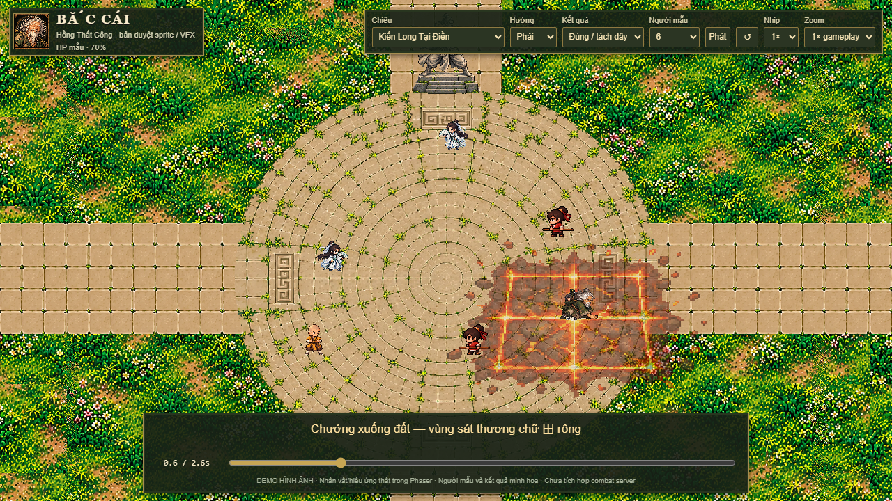
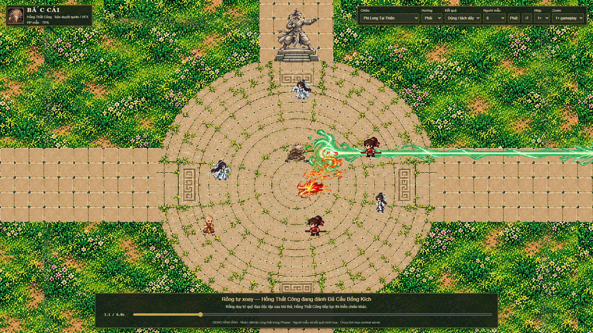

# Bắc Cái — director feedback v03, 2026-11-02

Status: **VISUAL V03 APPROVED FOR PHASER INTEGRATION — 2026-11-02**. The director explicitly approved the reviewed sprite/VFX choreography. Live combat/server integration and final runtime/balance approval remain separate. Record: `assets/reviews/bosses/bac_cai_v03/director_approval.json`; byte lock: `assets/approved_bac_cai.lock.json`. The same local viewer is `http://127.0.0.1:5343/bac-cai-preview.html`.

| Feedback | Change |
|---|---|
| Mục Hạ Vô Nhân crosses slowly | Five rounds of four crossing pairs. Each move takes1.4s, pairs begin120ms apart and settle340ms after the last pair;2.1s per full round. Original body remains trackable during splitting; all figures use the same artwork after splitting. |
| Đả Cẩu Bổng Kích looked broken | Four new authored long-beam cels use768×128 canvases with a fixed emitter/centerline and uniform runtime scale1. The old tiny beam stretched4.8× horizontally is retained for historical comparison but replaced in choreography. Jab anticipates, contacts and recovers once, returning to idle at700ms. |
| Kiến Long explosion obscured the boss | Ground burst opacity0.55, below every actor; boss is fully opaque and above the co-located target at impact, with standing recovery after780ms. Radius/field footprint is preserved. |
| Preference speech while attacking | Dialogue/preferences are a separate channel. Before vote resolution the preview simultaneously alternates Đả Cẩu Bổng Kích and Hàng Long18 Chưởng. Sleep/drinking outcomes retain their existing exclusive animations. |
| Release dragon and continue fighting | One cast releases the dragon at400ms; body is free at650ms. Dragon follows its own clock and fixed-origin spiral while the boss uses the separate action channel. |

The times above are configurable presentation defaults in `bac-cai-preview-tuning.ts`, not final combat tuning. Real server casting, invulnerability, damage, preference clock, RNG and voting are still unimplemented in this art viewer. Existing character source/concept/atlases and v02 sources/PNGs/evidence are retained unchanged. No recordings.

The supplementary native beam is original built-in `image_gen` artwork. Source, exact prompt, generator filename, uniform extraction scale, source/output hashes and metadata are under `assets/sprites/bosses/main/bac-cai/rework-v03/`. It reuses the retained v01 packer without executing the old exports. A flattened PNG source is supplied, not a layered Aseprite document. Applicable OpenAI service terms apply; no third-party license is asserted.

Review targets remain actual normal gameplay zoom and the original Bắc Cái concept. The new beam keeps the jade/ivory palette and crisp pixel clusters. Ground burst alpha/actor ordering addresses readability without replacing art with primitives. Old v02 evidence remains historical; new evidence is under `docs/evidence/bac-cai-preview-v03/`.

## Actual Phaser review

Opened the actual 1280×720 field-impact screenshot: the full olive/white boss silhouette is visible over the reduced-opacity 田 burst, including during the crouched contact cel. Opened the1920×1080 concurrent-dragon screenshot: the released red/orange dragon is separate from the boss's staff jab and new green beam. The preference screenshot shows the overhead wine sentence while the beam is active. The beam screenshot confirms a crisp long strip at uniform scale without the old anisotropic enlargement.

The browser report includes sampled real rendered positions during the slow center crossing, rather than only timeline seeks. Both correct/incorrect clone branches, solo tether behavior and vote outcomes remain covered. All408 non-hero frames/102 clips were observed on successive Phaser render ticks in two viewport contexts, with no console errors or preview WebSockets.

[Exact beam generation prompt](../assets/sprites/bosses/main/bac-cai/rework-v03/source/generation_job.json). Existing one-facing thrust, frontal drinking/sleeping and dog-direction production gaps remain as disclosed in the v02 review. The explicit approval covers the visual preview as reviewed; it does not invent missing directional artwork. Historical source/evidence metadata retains its original pending labels; the current approval record supersedes those delivery-time labels.

## Final validation

- `python -X utf8 scripts/verify-bac-cai-preview.py`: PASS,56 supplementary PNG cels/14 clips,425 existing Bắc Cái files unchanged, source hashes/alpha/pivots/atlas pixels and native beam scale verified.
- `pnpm check:quick tests/bac-cai-preview.test.ts`: PASS,12 focused tests for crossings, pauses, outcomes, beam recovery, floor ordering, dialogue/casting and detached dragon.
- `pnpm check:browser tests/e2e/bac-cai-preview.spec.ts --trace off`: PASS,408 frames/102 clips plus real-time crossing observations, concurrent speech/beam and dragon/beam checks in two independent viewport contexts. Iteration browser stage111.26s.
- After the last implementation change, `pnpm check:final tests/e2e/bac-cai-preview.spec.ts --trace off`: **PASS**. Both TypeScript checks,18 workflow tests,483 unit/integration tests across42 files, production build, all16 asset validators and the scoped browser case passed. Final browser stage80.68s; complete single-pass pipeline311.56s. These are measured durations, not speed guarantees. Session name`bac-cai-feedback-v03-final`, server/client2742/5342; reused the existing Chromium binaries.

Machine evidence: `evidence/bac-cai-preview-v03/verification.json`, `evidence/bac-cai-preview-v03/final-validation.json` and `evidence/sessions/bac-cai-feedback-v03-final/check-workflow/final-timings.json`. No server/core gameplay implementation or multiplayer-combat acceptance is claimed. Unrelated validators' generated historical reports were restored after the checks; runtime inputs and the reviewed assets were unchanged by that bookkeeping. The local demo on5343 remains available for director review.
