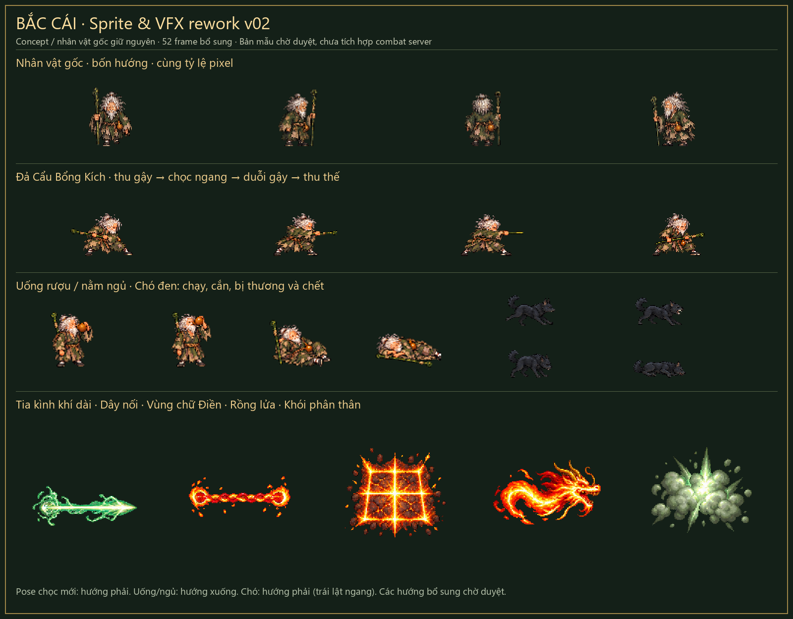
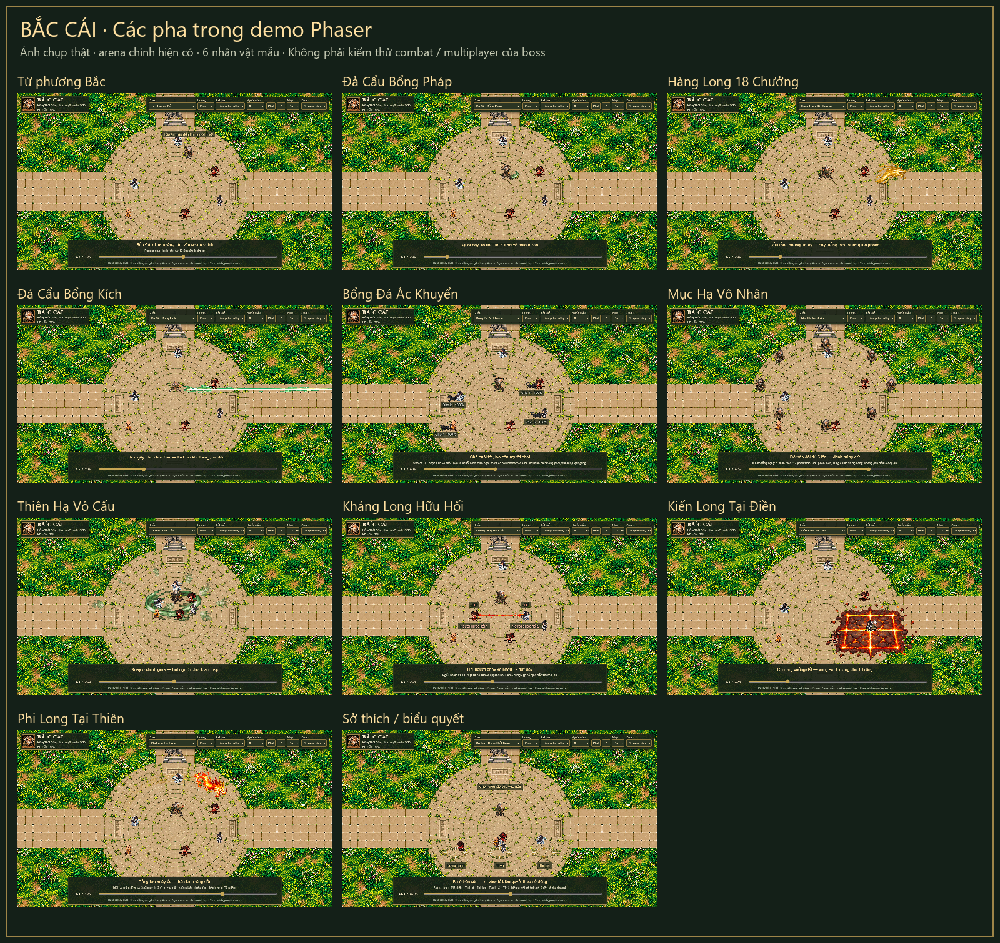

# Bắc Cái sprite / VFX preview v02 — 2026-11-02

Historical v02 review; subsequent director feedback is implemented in [BAC_CAI_FEEDBACK_V03.md](BAC_CAI_FEEDBACK_V03.md). Its separate v03 evidence preserves all images/reports below.

Status: **PROTOTYPE — PENDING DIRECTOR REVIEW**. Branch `wip/m3d/bac-cai`. The final mechanic brief is [BAC_CAI_FINAL_DESIGN.md](BAC_CAI_FINAL_DESIGN.md). This is an isolated Phaser 4 art viewer, not an integrated boss encounter.

Open `http://127.0.0.1:5343/bac-cai-preview.html`. Select a named action, facing, success/failure, one/two/six hero models, playback speed and 1×/2× zoom. The timeline supports seeking. The second dropdown group auditions individual retained/new raster clips for comparison; historical counter/ultimate poses in that group do not add those mechanics to the boss.

To restart from this worktree:

```powershell
pnpm assets:prepare
pnpm --filter @volam/game-client exec vite --host 127.0.0.1 --port 5343 --strictPort
```

## Deliverables and reuse

The existing concept, 224 character cels and all old Bắc Cái art remain intact. The static validator pins **425 existing files**. The viewer uses four retained VFX atlases (128 cels) and **52 newly authored supplementary cels**. Total non-hero playback coverage: **404 cels / 101 clips**. Approved hero atlases provide scale/readability models.

| New component | Cels / clips | Canvas / pivot | Scope |
|---|---|---|---|
| `bac_cai_rework_character` | 12 / 3 | 160×112 / (80,88) | Billiards thrust right; drinking and sleep transition down |
| `bac_cai_black_dog` | 20 / 5 | 96×80 / (48,64) | Idle, run, bite, hurt, death right; left mirrors |
| `bac_cai_rework_vfx` | 20 / 5 | 192×192 / (96,96) | Straight qi beam, pair tether, 田 impact, fire dragon, clone smoke |

All sources, original/superseded generation attempts, exact prompts, retained PNG hashes, extraction rectangles, shared scale and animation metadata are under `assets/sprites/bosses/main/bac-cai/rework-v02/`. These are original built-in `image_gen` outputs, subject to applicable OpenAI service terms; no third-party license is asserted. The source format is flattened PNG plus reproducible export, not layered Aseprite. The first drinking source had a duplicate waist gourd; the targeted corrected source is used and the initial source is preserved.

| Final action | Retained material / rework |
|---|---|
| North entry | Existing down walk and stance; main-arena background reused, no new arena |
| Đả Cẩu Bổng Pháp | Existing staff combo/sweep; forward lunge choreography |
| Hàng Long 18 Chưởng | Existing palm release and straight dragon-head projectile |
| Đả Cẩu Bổng Kích | New horizontal billiards jab and long narrow jade beam; illustrative 350ms warning |
| Bổng Đả Ác Khuyển | Four new black dogs with separate movement/bite/hurt/death and scripted HP; hero counterattack poses |
| Mục Hạ Vô Nhân | Real body slowly leaves the center while copies form at eight surrounding positions; identical bodies after formation, exactly five swaps; both answer branches |
| Thiên Hạ Vô Cẩu | Existing directional staff-spin cels, inward wakes and ground smash; hero positions remain pulled at impact |
| Kháng Long Hữu Hối | New player-to-player tether with pulled pair, drain/break and disabled-solo branch |
| Kiến Long Tại Điền | Old jumping-palm reassigned; new broad 田 ground impact |
| Phi Long Tại Thiên | New red/orange fire-dragon head follows increasing-radius spiral; retained faint qi trail |
| Preferences | Six overhead dialogue lines; three floor options; scripted majority; sleep/free attacks or disappointed drinking/+10% HP |

## Actual visual review





Opened the actual exported atlases and real screenshots at logical 1280×720 and display 1920×1080. The retained white hair/beard, patched olive robes, rope, gourd and bamboo silhouette match the existing approved-direction concept. The new pose group keeps the same native canvas/feet convention. The black dogs are natural charcoal hounds, unlike the rejected reuse candidate Ma Khuyển's red/flaming demonic appearance. The fire dragon is visibly red/orange rather than the older golden qi. The 田 effect has an outer square and center cross, rather than reusing the old counter shield.

Compared with the positive Võ Đang/world/arena references, authored cels and deliberate poses retain the required detailed elevated chibi presentation. Compared with the placeholder anti-reference, no procedural character/tree/energy primitives are substituted for finished illustrations. The existing arena ground still has stronger repetition and less architectural dressing than the positive concept; it was reused as instructed, not redesigned or newly approved. The dashboard anti-reference file currently contains a character reference sheet; the written in-viewport overlay rule is still followed.

The long beam extends across the view. The field is intentionally broad and visually dense at impact; its final opacity/scale and the dark dogs' contrast on grass remain director-review points. The fire spiral's path must be judged in live playback; its screenshot only shows one phase. Main preview controls/captions remain inside the full viewport.

## Verification and limitations

- `python -X utf8 scripts/verify-bac-cai-preview.py`: source/protected hashes, 52 PNG frames, 13 clips, binary alpha, padding, pivots and exact PNG/atlas equality.
- Browser observations: each of 404 cels rendered on actual successive Phaser ticks, complete cycles for 101 clips in two independent viewport contexts; normal scale, fixed camera, four retained boss directions, branches and six scripted hero-model readability; no preview WebSocket or console errors. Machine report: `evidence/bac-cai-preview-v02/verification.json`.
- Final project validation/results are appended below after completion. Browser trace/video are disabled for the new preview test. No recordings were created.
- No boss AI, damage, collision, RNG, real invulnerability, voting, dog HP, tether thresholds or multiplayer state were implemented. Those remain server-authoritative integration work. Six local hero models are not six network clients.
- The new thrust has one authored facing; the other three show explicitly disclosed old-combo fallbacks. Drinking/sleeping are front-facing. Dogs lack authored north/south. Sleeping holds the authored reclined cel after sitting/reclining, then wakes; separate breathing cels are not supplied. This is a coherent demo, not a complete production animation set.
- A fresh-worktree guard initially failed because four unrelated Hong Liet metadata files were checked out CRLF although their runtime manifest pins LF. Restored exactly the pinned LF bytes and added four `.gitattributes` overrides; no approved hashes or guard logic were relaxed.

Re-export only the new set with `python -X utf8 assets/sprites/bosses/main/bac-cai/rework-v02/source/export_v02.py`. It reuses the existing v01 preparation/packer definitions without executing the old exports. Review boards can be rebuilt with `python -X utf8 tools/bac-cai-review-boards.py` after the browser captures.

## Final validation results

Ran from the requested worktree with `VOLAM_QA_SESSION=bac-cai-preview-final`, server/client ports 2742/5342 and the existing Chromium cache:

```powershell
pnpm check:final tests/e2e/bac-cai-preview.spec.ts tests/e2e/gameplay.spec.ts --grep 'Bắc Cái|two clients agree|ranged projectile'
```

Final code passed both TypeScript checks, **18 workflow tests**, **478 unit/integration tests in 42 files**, production build and **all 16 asset validators**. The new preview browser case passed with 404 cels / 101 clips, two independent viewport contexts, fixed camera/native pivots, the corrected original-body flight, all final-brief branches and no console errors or WebSockets. The existing straight-projectile browser case passed in17.2s.

The combined run exited1 because the extra historical two-client gameplay smoke lost its second connection (1006) during joining. A previous run reached gameplay but hit that case's60s timeout. No production gameplay code was changed to work around those failures. Reran only that failed stage, preserving passed checks:

```powershell
node tools/run-playwright.mjs test tests/e2e/gameplay.spec.ts --grep 'two clients agree' --trace off
```

**PASS: 1 test,26.6s (29.3s including setup)**. Thus every required stage and all three selected browser cases passed, with the failed combined-run status retained rather than relabeled. Raw single-pass stage timings remain under `evidence/sessions/bac-cai-preview-final/check-workflow/final-timings.json`; final scope/results are summarized in `evidence/bac-cai-preview-v02/final-validation.json`. Unrelated validators' generated historical reports were restored to their original bytes after checking. No runtime inputs were changed by that cleanup.

The preview server remains available on local port5343. No merge or final art approval is implied. All new art remains a director-review prototype; direction/breathing gaps listed above are still open.
