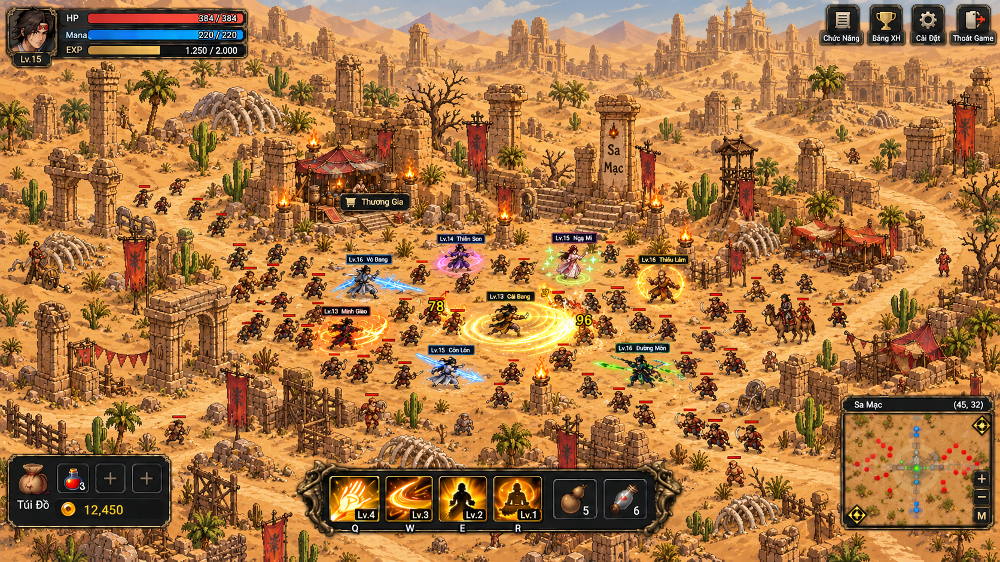
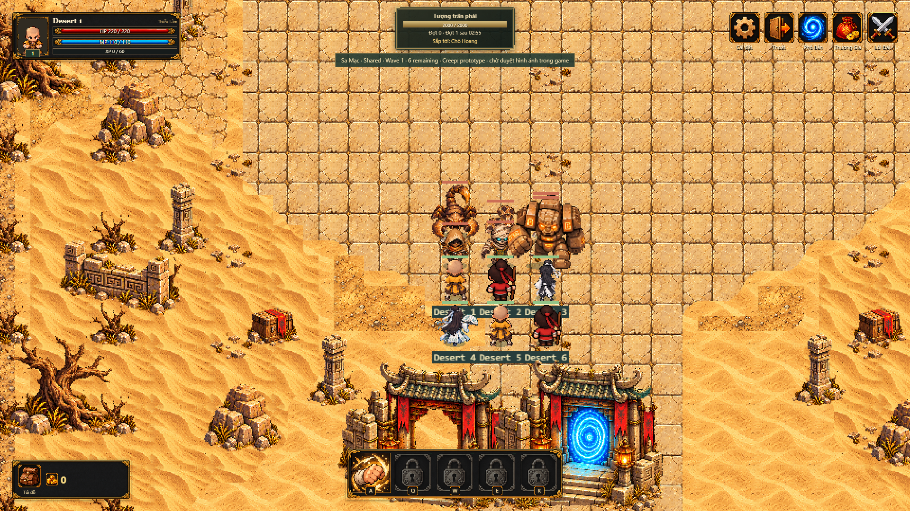

# Sa Mạc integration — 2026-10-31

The user explicitly requests integration of the retained desert asset handoff. The Phó Bản overlay now offers **Sa Mạc** with separate private/shared creep instances. Runtime director art approval remains **pending**. Existing approved source/export bytes and unrelated working-tree edits are preserved.

## Sources and approval

| Resource | Actual path | Status |
| --- | --- | --- |
| Primary scene benchmark | `assets/references/desert_dungeon_reference.png` | Direction reference only |
| Retained composition concept | `assets/concepts/dungeon-environments/desert/desert-environment-concept.png` | Concept; never used as a giant runtime background |
| Terrain | `assets/tilesets/desert/desert-terrain.png` and `.json` | 344 authored 32px tiles; runtime review pending |
| Props and static portals | `assets/sprites/environment/desert/desert-scenery.png` and `.json` | 20 retained props; runtime review pending |
| Six actor atlases | `assets/sprites/creeps/dungeons/desert/<id>/{spritesheet.png,atlas.json,animations.json}` | Accepted creep concepts; runtime sprites remain prototype |
| Original provenance / hashes | `assets/source/desert/asset_manifest.json`, `generation_prompts.json`, `export_recipe.json` | Original AI-assisted rasters; no commercial pack or exclusive copyright assertion |
| Integration manifest | `assets/desert_dungeon.manifest.json` | Generated from retained metadata; approval pending |
| Composed Tiled map | `maps/creep_desert.tmj` | Original placement/layout; shared server/client geometry |

Roster: `bo_cap_cat` (Bọ Cạp Cát), `sa_xa` (Sa Xà), `sa_tac` (Sa Tặc), `cung_thu_sa_mac` (Cung Thủ Sa Mạc), `xac_uop` (Xác Ướp), `cu_nhan_sa_thach` (Cự Nhân Sa Thạch).

The art handoff supplies **no species-specific combat profiles**. All six appearances reuse the existing M2A generic creep stats, AI, attack cadence, rewards and scaling, without new numeric tuning. Their identities rotate deterministically through successive waves. The archer currently uses that same common melee mechanic; ranged enemy shots, poison, golem area damage and other specialized abilities require authored gameplay definitions. Names and available VFX do not imply those mechanics exist. Retained desert VFX/arrow PNGs remain available but are not emitted as imaginary authoritative attacks. No balance claim is made.

## Implementation

- `scripts/build-desert-map.py` composes retained tile/material pixels and prop references into an orthogonal 1536×1024 map. It does not create or modify artwork. The map has ground/paving/details, 128 scenery placements, authoritative solid footprints and twelve creep markers. Material phases follow world-tile parity. The central court and southern approach remain open for six players.
- `scripts/prepare-desert-assets.mjs` copies retained PNG/JSON bytes, derives an animation manifest from real atlas/tag metadata, and copies one authoritative map into the client and game-data. It uses the existing byte-change helpers. Source hashes and production status remain explicit.
- `game-core/DungeonMatch` keeps its forest default and registers additional definitions. Each non-arena zone carries its own definition, world, geometry and wave clock. Alive/arena checks, ownership/capacity, spawn-time scaling, empty pause/resume, build restrictions, transfer cleanup and physical exit distance validation remain authoritative.
- Protocol **11** adds validated optional `destination` (`forest`/`desert`; omission preserves forest) and server-selected `CreepState.archetypeId`. Clients never submit enemy stats or results. Existing StateView and combat-event filtering isolate each destination/private instance.
- `desert-art.ts` loads the actual six atlases, registers all 120 tags and retains explicit frame durations. Idle/walk loop; attack/hit/death play once; Sa Xà uses its actual three-frame death sequence. Existing `CreepPlayback` completes one-shots across shorter network poses. Pivots come from original metadata; no actor scaling is introduced.
- The scene switches map bounds/presentation by authoritative zone. Ground decals render below actors; scenery uses foot pivots/Y depth; foreground sorts against character feet. Zone changes destroy old sprites, effects, events and display objects. HUD/menus remain within the full viewport.

## Reference inspection

Inspected the required desert/world/character/menu references, current placeholder-quality anti-reference, ART_PRODUCTION_STANDARD and UI_UX_SPEC before edits. The target is ochre sandstone, red fabric, layered ruins, broad paths and compact chibi actors at unchanged normal camera zoom. The old `vo_dang_art_direction_reference.png` alias is absent; inspected `vo_dang_character_reference.png` as documented by the desert handoff. `current_codex_dashboard_anti_reference.png` actually contains a Võ Đang concept sheet, a known filename/content mismatch; the written prohibition on exterior dashboard panels still applies.

This integrates existing art for review. It neither grants ART-01/director approval nor starts bulk art production. Entrance/exit artwork remains static; no fake portal animation is claimed. Final screenshots need comparison with the references at normal zoom; automated results cannot grant director approval.

## Validation

- `python -X utf8 scripts/verify-desert.py`: PASS — all 380 frames / 120 tags, original production hashes, atlas/frame pixel parity, timings, runtime copies and map contracts.
- `pnpm check:quick tests/desert-dungeon.test.ts tests/dungeons.test.ts tests/dungeon-room.test.ts`: PASS — 21 tests across three files.
- `pnpm check:browser --config playwright.desert.config.ts tests/e2e/desert.spec.ts --grep "two clients"`: PASS — two browser contexts observed all frames/tags, complete idle/walk cycles and one-shot completions, facing, timing, native scale and pivots. Controlled server poses are separated from natural combat. Fixture corrections excluded pre-existing natural-enemy timing samples and gave each terminal death pose an independent entity identity; production combat was not adjusted.
- Final pipeline completed project/test/tool typechecks, **335 unit/integration tests across 27 files**, **8 workflow checks**, production build and **11 asset validators** successfully. Its browser stage passed the two-client frame review (28.9s) and both existing forest shared/private cases (36.2s/42.3s), but the initial six-browser lobby setup failed before dungeon entry. This is retained as a failed attempt, not reported as a successful `check:final` exit.
- Adapted only the party test to the repo's established **two browser contexts + four real SDK clients** pattern. Six server-owned players are rendered together by Phaser. The first rerun passed natural combat and rewards, then exposed a test assertion assuming radius 12 instead of the configured 10; the actual server collision was correct. Failure PNG/state are retained as `combat-failure.png/json`.
- `pnpm exec tsc -p tsconfig.tools.json --noEmit`: PASS after the test-only corrections.
- `node tools/run-playwright.mjs test --config playwright.desert.config.ts tests/e2e/desert.spec.ts --grep "six players"`: **PASS**, 36.7s test / 39.5s browser run. Natural server AI, six deaths, fixed **360 total XP**, synchronized reward state, next wave, live player collision, in-viewport rendering and physical exit/old-sprite cleanup passed. No combat stats or rewards were changed for the test. The successful full-suite/build/asset/frame/forest stages were retained, as required by DEVELOPMENT_WORKFLOW; only the affected browser case was rerun.
- All 380 frames/120 tags were observed; the final frame report measured maximum sampled frame-interval deviation **26.6ms** from authored timings. This observes visual scheduling, not authoritative attack timing. Error lists in the successful frame/combat reports are empty. No video/animated-image or trace evidence was generated.

Final command: `pnpm check:final --config playwright.desert.config.ts`. It covers all typechecks/unit/integration checks, build, asset validators and selected live-browser desert/forest tests. Arrangement endpoints belong only to the test service on dedicated ports 2596/5196 and never enter the shipped protocol.

## Actual runtime comparison and remaining art review

Opened and visually inspected both final PNGs at normal gameplay zoom: `docs/evidence/desert-integration-2026-10-31/desert-six-player-1920.png` and `desert-combat-1280.png`. `frames.json` contains the observed animation frames/repeats/timings; `combat.json` records the successful natural-combat scope. These are real Phaser captures, not concept mockups.

| Primary reference | Actual six-player Phaser capture |
| --- | --- |
|  |  |

The retained ochre/russet terrain, sandstone props, red fabric and cyan exit share the reference's theme. Character bodies, raised scorpion tail, low viper and larger golem are distinct; the fixed elevated camera and crisp pixels are retained. The map fills the viewport behind HUD overlays, with no exterior dashboard. Compared with the reference, the current court has more regular, repetitive paving and simpler decoration; the deliberately tight combat fixture produces crowded silhouettes/nameplates. The capture focuses on the southern approach, rather than showing every northern architectural placement. Static portals remain static. These are explicit review limitations; the integration is functional but **not director-approved final art**. No further world/style propagation is authorized by this report.

## Files changed in this task

- Data/core/protocol: `packages/game-data/src/{desert.ts,creep-desert-map.json,dungeon.ts,index.ts}`, `packages/game-core/src/{dungeons.ts,types.ts}`, `packages/game-protocol/src/index.ts`.
- Runtime: `apps/game-server/src/rooms/MatchRoom.ts`; `apps/game-client/src/{desert-art.ts,dungeon-presentation.ts,art.ts,arena-scene.ts,arena-creeps.ts,main.ts,ui.ts,menus.ts,dungeon-selector.css}`.
- Map/asset tooling: `maps/creep_desert.tmj`, `assets/desert_dungeon.manifest.json`, `scripts/{build-desert-map.py,prepare-desert-assets.mjs,prepare-assets.mjs,verify-desert.py}`, `package.json`. Generated client/public asset copies are ignored runtime outputs; retained original desert PNG/JSON files are unchanged.
- Tests: `tests/desert-dungeon.test.ts`, `tests/dungeon-room.test.ts`, `tests/e2e/{desert.spec.ts,desert-setup.ts,arena-visual-v2.spec.ts}`, `playwright.desert.config.ts`. The existing selector regression checks unavailable Biển instead of newly supported Sa Mạc.
- Documentation: this report, `DECISIONS.md`, `TECHNICAL_ARCHITECTURE.md`, `ACCEPTANCE_TESTS.md`, `ROADMAP.md`. Other pre-existing edits are outside this task.

## Manual review

Run `pnpm dev`, create/join a room, start and confirm schools. In the arena click **Phó Bản → Sa Mạc → Riêng/Chung → Vào Phó Bản**. Arrow keys move; A and QWER retain their current authoritative behavior. Walk to the cyan **Lối Ra** in the southern approach and click to return to the arena. Opening menus does not pause the server, and loadout changes remain arena-only. Review the environment and all six appearances at normal zoom before recording director approval.
