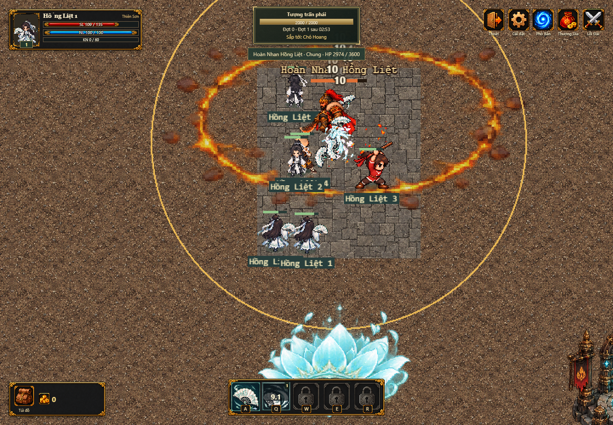
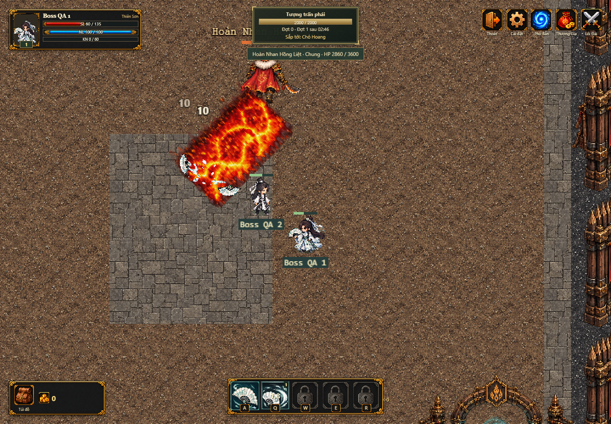

# Hoàn Nhan Hồng Liệt — runtime v04

Worktree: `C:/Users/ADMIN/.codex/worktrees/hoan-nhan-hong-liet/volam-hero-defense` · branch `wip/m3d/hoan-nhan-hong-liet`.

Preview `82eaa5ca`, director approval `d62da39e`. The approved review bundle remains unchanged. Art approval and the gameplay verification below are separate records. This task adds only this encounter; no merge or deployment.

## Run and enter

From this worktree run `pnpm install --frozen-lockfile`, then `pnpm dev`. Open the client URL printed by Vite, create/join a room, start and confirm a school. Open **Phó Bản → Hoàn Nhan Hồng Liệt → Riêng / Chung → Vào Phó Bản**. Shared allows up to six; private belongs to one player. Walk to the return portal at the southeast of the yard and press **Space** to exit. Arrow movement, A and QWER retain their existing meanings.

The arena uses `maps/boss_hong_liet.tmj`: original 32px terrain tiles, independently placed PNG props, a northern command tent, perimeter equipment/palisades, a broad central yard and permanent lava rocks outside the fence. It does not use the concept overview as a background. Collision and spawn/bounds/exit markers feed the server configuration. Camera stays non-rotating at normal zoom; props and characters sort by feet Y, while ground effects stay under actors. HUD and menus remain inside the match viewport.

Installed packages: Phaser4.2.1, Colyseus core0.18.23, schema5.0.42 and SDK0.18.8. API usage was checked against installed declarations and official [Colyseus state](https://docs.colyseus.io/state), [Room](https://docs.colyseus.io/room) and [Phaser AnimationManager](https://docs.phaser.io/api-documentation/class/animations-animationmanager) documentation.

## Authority and lifecycle

`packages/game-core/src/hong-liet.ts` owns the seeded encounter director. It runs after the existing world step, targets living occupants, captures heading at windup and cycles nine actions with cooldowns/rests. No client message can start a boss action or submit hits, geometry, position, summons or rewards. Boss cue state contains authoritative positions, dimensions and stage ticks; protocol v14 and zone StateViews carry it to Phaser. Existing combat defenses, immunity, shields, death and reward functions process all hits.

A1 emits three concurrent lines at -18/0/+18 degrees, length **600 from the point 24 units in front of the boss**. A shared hit set permits at most one successful hit per hero per A1 cast even where lines overlap. A2 is a forward-only 180-degree arc of radius217 (the reviewed visual scale is 1.05 × 1.5; measured peak opaque radius216.7, rounded to217). Collision tests expand geometry by the existing hero body radius; rear centers never qualify for A2. Each cannon/archer projectile hits a given hero once. Different cannon bolts can each hit; there is no accidental per-frame multiplication.

Lava dash uses swept server collision over24 ticks/0.8s. The trail length follows actual traveled distance, so it does not damage or render in front of the feet. Active lava stays fixed, ticks every15 ticks/0.5s, permits re-entry hits and ends damage at11 seconds after release. Its48-tick/1.6s cooling tail is presentation only. Volcanoes warn five points; meteor waves warn twelve seeded points with larger radii. Archers fire captured straight directions; infantry uses existing approach/melee AI and has no horses.

Cannon setup creates16 hardware cues: four per edge. Eight unique full-length lane warnings start together. Every volley creates16 straight bolts on both axes simultaneously; spawning stops after4.2s, and the director waits for the longest complete field crossing before removing hardware. World marker dimensions determine travel distance, not screen coordinates.

Difficulty is fixed for1–6 occupants. The empty encounter immediately cancels casts/projectiles/hazards/summons and resets HP/position after30 seconds. Boss respawn is configurable, initially30 seconds. Boss death, all-player death, exit, abrupt disconnect and reset cannot leave hostile transient entities behind. Room empty-reset clocks also advance while a late joiner is still selecting a school.

Existing reward backend splits one fixed900 XP /240 gold pool among present eligible attackers, once per kill. **Item drops and eligible-player item rolls are not implemented in the existing backend. This integration creates no fake item or loot UI.**

## Provisional tuning

All tuning is in `packages/game-data/src/hong-liet.ts`, validated at startup. Geometry approved in v04 is retained; HP/damage/cooldowns below are trial values, not director-approved balance.

- Boss: HP3600, defense18, speed85, radius22; rest0.8s, first rest2s. Forced displacement is disabled. Crowd-control duration multiplier0.2; already committed telegraphed casts resolve, while stun delays the next action.
- A1: damage22, windup0.7s. A2: damage26, windup0.7s.
- Dung Nham Liệt Địa: damage24, radius220, windup1s, stun1.2s on heroes.
- Hỏa Sơn Bạo Phát: damage27, radius80, windup1.1s, five points staggered0.16s.
- Liệt Diễm Phong Tỏa: length up to550 before collision, half-width45, windup1s, dash0.8s, damage9 per0.5s tick, active11s then cool1.6s.
- Hỏa Tiễn Tề Phát / Thiết Kỵ Triệu Binh: four summons per cast, maximum8 combined, lifetime25s. Minions HP95, damage9; archer speed420/range450, straight flight. Summons give no XP/gold.
- Vạn Lý Nham Hỏa: damage32, radius110, twelve points staggered0.38s, minimum warning1.2s.
- Hỏa Pháo Thiên La: damage17 per bolt, speed600, radius8, warning1.6s, fire4.2s, interval quantized to20 ticks at30Hz, then drain. Four row/four column marker positions are world data.

`tools/hong-liet-balance.ts` runs192 deterministic60-second cases: seeds42/1337/9001, levels1/6/15/30, all eight school normal styles, solo and six bots, legal mixed four-slot builds and ordinary respawn/re-entry. It uses input-driven movement/attacks, with no combat HP or position overrides. The report is `docs/evidence/hong-liet-runtime/balance.json`. These simple bots are a tuning probe, not a model of expert dodging. Clear counts within60s: solo0/0/0/9 of24 at those levels; six19/18/24/24 of24. Low-level solo is deliberately demanding; these measurements do not settle final encounter balance.

## Retained art mapping and limitations

`assets/runtime/hoan_nhan_hong_liet_v04.json` lists allowed cels, original file SHA256 hashes, provenance and display transforms. Preparation checks the director-approved hashes and runtime inputs, dimensions and frame bounds. It does not relabel every exported cel as approved.

- Locomotion: approved four-facing idle/walk. A1 vertical contact uses `boss_thrust_vertical` stages1/2; original `boss_basics` supplies anticipation0/recovery3. Other basics/casts use their approved directional sheets.
- Meteor descent substitutes `vfx_meteor_safe:fall_0/1` for the clipped original `cast_2/3`; those defective originals are excluded.
- Lava uses `vfx_lava_lane_v03` with the reviewed lighter rim and per-frame anchors. Original lava cast0 is used only for cannon lane warning art.
- Cannon uses `cannon_clean` plus separate muzzle/projectile VFX. Side hardware keeps the selected corrected contact cels; muzzle movement does not depend on swapping into defective poses.
- Minions use approved walking infantry/archer PNGs. Missing vertical attack contacts have explicit right-facing contact aliases. No horses are added.
- No authored hurt/death sequence exists. Hurt briefly tints the current approved pose; death holds a dim idle silhouette until authoritative respawn. Minions are removed on authoritative death without an authored corpse sequence. These fallbacks are disclosed, not new final-art approval.
- Headquarters tiles/props have retained original-generation provenance. The newly composed runtime map has not received separate director approval at normal gameplay zoom.

Phaser4 WebGL uses frame crops for front-only sweep/lane clipping. No unsupported legacy GeometryMask path or procedural replacement character/environment art is used.

## Verification and evidence

Focused commands actually run during implementation:

- `pnpm exec tsc -b --pretty false` and tools/test typecheck: passed after fixes.
- `pnpm exec vitest run tests/hong-liet.test.ts tests/dungeons.test.ts`: boss + dungeon regressions passed; final totals are recorded below.
- `pnpm exec vitest run tests/dungeon-room.test.ts tests/hong-liet.test.ts`:28 passed, including real Colyseus cue/event projection, private view isolation and abrupt disconnect.
- `pnpm --filter @volam/game-server exec tsx ../../tools/hong-liet-balance.ts`:192 runs completed.
- Edge/Playwright two-client and six-client focused natural gameplay checks passed during iteration. Both use actual lobby/menu/keyboard flows and a read-only evidence bridge. No invulnerability, ranks, HP, boss phase or positions are changed by the browser tests.

Final required command: `pnpm check:final --config playwright.hong-liet.config.ts`. Final status, counts and current screenshots are appended after execution. This scope builds production and tests the running Phaser client through isolated Vite services on server2791/client5391. Browser video and trace are off.

PNG evidence and bounded frame/position observations are under `docs/evidence/hong-liet-runtime/`. The final screenshots must be opened and compared with approved v04/arena references. Passing tests verifies runtime behavior; it does not replace director approval or invent missing cels.

## Final result — 2026-11-01

`pnpm check:final --config playwright.hong-liet.config.ts`: **PASS**,238.61s.412 unit/integration tests,18 workflow checks, production build, all13 retained asset validators and2 real Phaser browser cases passed. The boss guard independently verified40 distinct approved pinned files and16 atlas inventories; the production mapping excludes defective/unused cels.

Final six-client run: all6 distinct players actually damaged the boss,159 authoritative hits, boss HP fell to1496/3600, max8 summons,16 cannons and6 alive concurrently in the active-party PNG. This acceptance demonstrates an actual fight; it does not claim a natural browser boss kill. Deterministic tests separately verify kill rewards/respawn. Client console/page-error arrays are empty. Boss locomotion was observed in all4 directions across the two/six-client runs; natural combat does not exhaustively display every cel in every direction.

Opened and inspected final `two-hong_liet_a1.png`, `lava-active-trail.png`, `six-active-party.png` and the cannon/meteor views against retained v04 assets and map layout. Full viewport/zoom1, stable nonrotating perspective and feet Y-depth were checked. The lighter lava trail appears behind the dash; minion and hardware silhouettes remain distinct. Close melee groups can still overlap their name labels; that readability limit is retained explicitly.

Reproduction and data: [runtime summary](evidence/hong-liet-runtime/runtime-verification.json), [full check log](evidence/hong-liet-runtime/final-check.txt), [balance](evidence/hong-liet-runtime/balance.json), [two-client frame/state observations](evidence/hong-liet-runtime/two-client-observations.json), [six-client observations](evidence/hong-liet-runtime/six-client-observations.json). Build reports the existing large client chunk warning. No video/GIF/trace, merge or deployment occurred.

