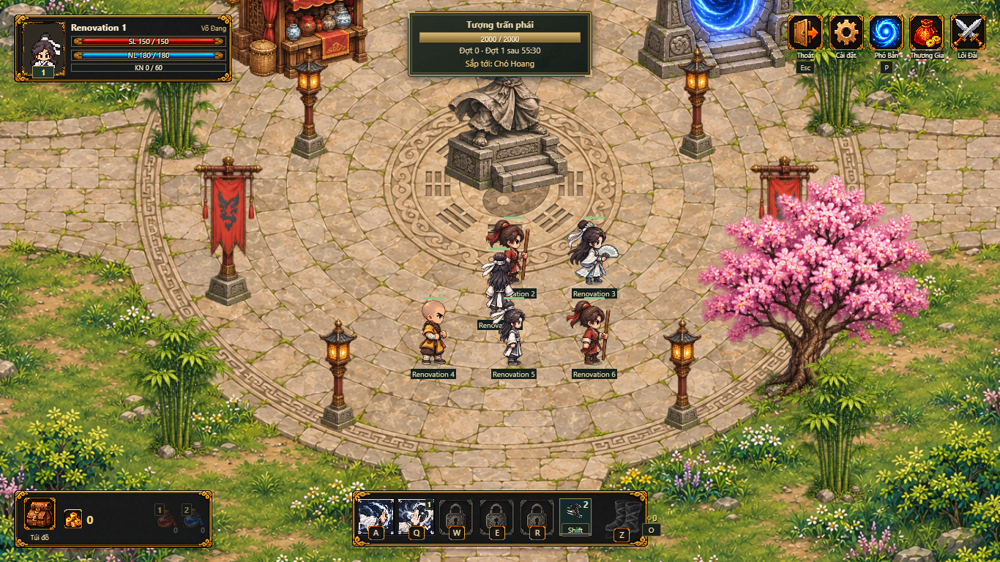

# Renovation v1 in the normal Phaser match

Worktree: `wip/m3d/visual-upgrade-2`. Director authorization: **“quá đẹp, hãy integrate vào phaser”**, 2026-11-05. The reviewed preview art is approved and pinned in `assets/approved_renovation_v1.lock.json`; the integrated appearance remains available for director review.

Run `pnpm dev:renovation` after building with `VITE_SERVER_URL=http://127.0.0.1:2926`. Open **http://127.0.0.1:5529/**, create a fresh room, choose a school and start normally. This entry point runs the normal server and client without the QA encounter fixtures. The separate `/renovation-preview.html` gallery remains available.

The normal renderer uses all 74 approved body forms: eight weapon branches, 20 invasion creeps, 24 dungeon creeps, seven forms of five wave bosses, 11 helpers/minions and four dungeon bosses. Arena and eight dungeon floors/props use the reviewed raster artwork. Native screen resolution and linear sampling preserve edge alpha; a hero body is about 88 screen pixels at camera zoom 1. Feet determine the pivot and foreground depth.

Only idle/walk artwork changes. Attacks, casts, hurt/death and transitional drawings retain their existing sources, phase clocks and effects, scaled to the new body height. The 6,640 frozen skill source/export images remain unchanged. Server movement, collision rectangles, targeting, damage, wave progression and rewards are untouched. The new scene floors are static raster backgrounds; older tile-based water/lava animation is not substituted as new artwork.

`assets/exports/renovation-v1/runtime/` contains losslessly trimmed atlases. Aseprite packs the approved cels without resizing or repainting. Pixel equality, source dimensions, trim offsets, durations and feet are verified for all 1,480 cels. Packed textures use **64.46 MiB** of RGBA pixel storage, versus 459.06 MiB for the padded preview sheets (excluding other retained textures and driver overhead).

Validation:

- `node tools/verify-renovation-runtime.mjs`: two real browser clients during iteration; `iteration.json` and console log. Ordinary arrow inputs prove all four walk directions, all four authored walk cels and peer position synchronization. A/Q inputs prove retained action bodies, server damage/death, XP/gold and return to the new idle art.
- `pnpm check:final --config playwright.renovation-runtime.config.ts`: final production build and six real browser clients, full repository tests and asset validators. `live-integration.json` records results and timings after it passes.
- Coverage fixtures run only inside the test server process: original wave-director spawns, legal server zone entry/exit, and held encounter actors exercise all 74 identities and eight dungeons through normal replicated state and normal scene renderers. Boss poses/phases and helper placements in this coverage section are fixtures, not a claim of naturally defeating all bosses. Collision/state logic is unmodified.
- PNGs show the normal game at native 1366×768, including HUD overlays and authored foreground props. No video or animated evidence is generated. Raw sources, exact prompts, provenance and editable Aseprite files remain in `assets/source/renovation-v1/`.

Final result: **PASS**, `pnpm check:final --config playwright.renovation-runtime.config.ts`, **279.10s**. TypeScript passed; **744 tests in78 files**,18 workflow checks,23 asset validators, production build and the six-client browser scenario passed. See `../sessions/renovation-runtime-final/check-workflow/final-timings.json` and `final-console.log`. The browser scenario took89.27s including startup/cleanup. `live-integration.json` records74 identities,8 dungeon instances, A/Q actions, shared enemy death/rewards, the native canvas, observed real texture/frame names and Y-depth.

During iteration, coverage exposed the retained Trúc Lâm Kiếm Khách idle/walk override and the tiểu đồng `carry_walk` alias; both now route to renovated bodies. Initial held-roster testing used an unprefixed Hell test identity, which was corrected to the real server roster. `last-failure.json` preserves that superseded fixture failure. Successful final validation contains no browser/page/HTTP errors. The accepted skill source bytes and legacy combat art remain pinned; the Thiếu Lâm validation report's approved-file count increases because it includes the new437-file renovation approval lock.

Other native PNGs: [retained Q body/VFX](normal-retained-skill.png), [combat return to idle](normal-combat.png), [Rừng Trúc](normal-forest.png), [Sa Mạc](normal-desert.png), [Bãi Biển](normal-sea.png), [Địa Ngục](normal-hell.png), [Chu Bá Thông](normal-chu_ba_thong.png), [Hoàn Nhan Hồng Liệt](normal-hong_liet.png), [Kim Luân](normal-kim_luan.png), [Cổ Mộ](normal-co_mo.png). Positions and simultaneous boss/helper appearances in coverage images are explicitly server fixtures, not a change to encounter progression.
